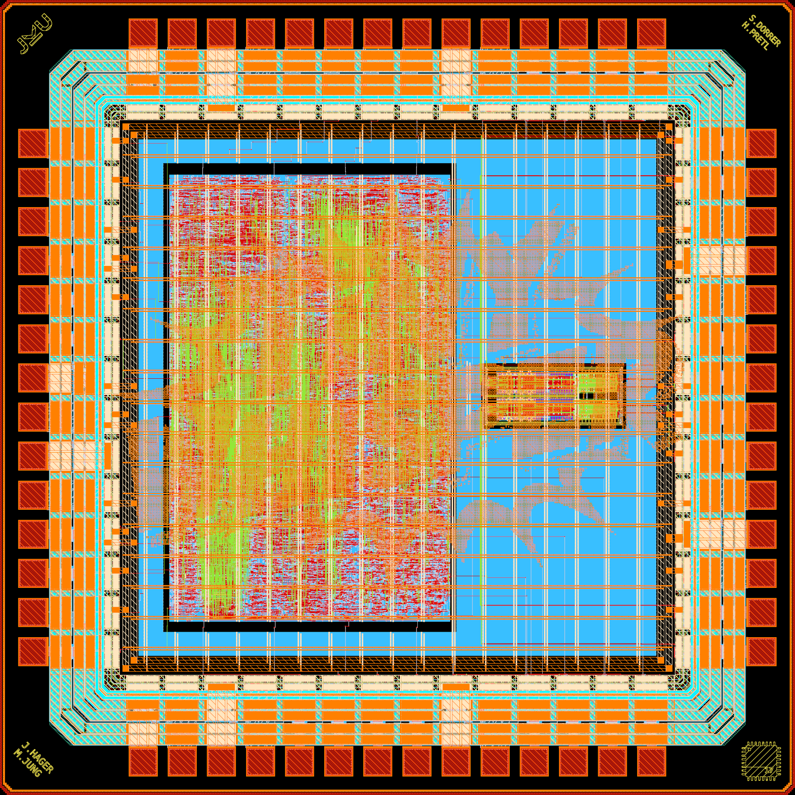
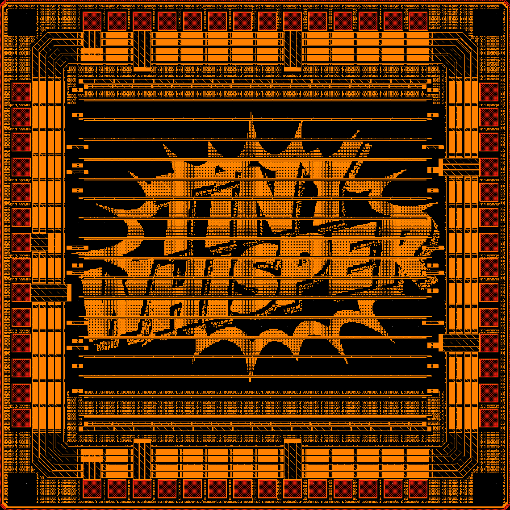

::: {.callout-important}
This repository requires the [IIC-OSIC-TOOLS](https://github.com/iic-jku/IIC-OSIC-TOOLS) container with tag `2026.11` or later. All commands below run inside the container, from the `ihp130/` folder of the repository unless a command names another folder. `2026.11` is the first image with the `sak-pex.sh -k` and the kpex 0.10.0 that `klayout-pex` uses, see @sec-requirements.
:::

::: {.callout-note}
The first silicon of the March 2026 tapeout (`SoC4219`) is back from fabrication and has not been measured yet. The [errata sheet](https://github.com/iic-jku/TinyWhisper/blob/main/ihp130/doc/errata.md) lists the predicted deviations of that silicon with a workaround for each. Three of them keep the chip from booting or from transmitting in band unless the board or the firmware works around them, so read @sec-errata before you design a board or write firmware. We happily accept [pull requests](https://github.com/iic-jku/TinyWhisper/pulls) and [issues](https://github.com/iic-jku/TinyWhisper/issues).
:::

# Overview {#sec-overview}

TinyWhisper is a fully integrated short-wave transmitter for amateur radio in the 130 nm IHP SG13G2 technology, designed with open-source tools and the open-source `ihp-sg13g2` PDK [@Herman_2024]. A RISC-V CPU computes the baseband, a CORDIC and two delta-sigma modulators turn it into 1-bit I and Q streams, and an analog IQ modulator filters them and mixes them with a four-phase 25 % LO up to the 80 m, 40 m, 20 m or 10 m band. WSPR (Weak Signal Propagation Reporter) is the headline mode, and because the front-end is a generic IQ modulator, the same chip can also send FT8, SSB and CW. The 2 × 2 mm² chip was taped out on the IHP open MPW run of March 2026 as `SoC4219`, and the bare dies are back from fabrication (@fig-die).

WSPR is pronounced *whisper* [@Taylor_2010], which gave the chip its name: a tiny chip that whispers WSPR beacons around the world.

The project has three parts:

- **A chip.** Two hard macros in a ring of 56 IHP IO pads. `riscv_top` is a hand-written multi-cycle RISC-V CPU with the CORDIC, the delta-sigma modulators and the LO generator. `iqmod_top` is the analog IQ modulator, with two fully differential third-order multiple-feedback (MFB) low-pass filters on inverter-based OTAs and two passive voltage-mode mixers.
- **A flow.** Xschem, ngspice and CACE for the analog macro, Verilator, Icarus Verilog, cocotb and LibreLane for the digital macro, KLayout, Magic, Netgen, kpex and gdscheck for physical verification, and the LibreLane chip flow for the pad ring and the top level. Makefiles drive every step inside the IIC-OSIC-TOOLS container [@Pretl_2023; @Fath_2024].
- **A system.** C firmware for the CPU, a Python reference of the WSPR encoder, an automatically generated bonding diagram for the QFN-48 package, and a planned application board with a 3D-printed enclosure.

{#fig-blockdiagram width=90%}

## Videos {#sec-video}

Two videos of about 70 seconds introduce TinyWhisper to a general audience, the first in English and the second in German.

::: {.content-visible when-format="html"}
<p align="center">
  <video src="video/tinywhisper_intro_en.mp4" poster="video/tinywhisper_intro_en.jpg" controls preload="metadata" title="TinyWhisper introduction video in English" style="width: 45%; min-width: 280px;"></video>
  <video src="video/tinywhisper_intro_de.mp4" poster="video/tinywhisper_intro_de.jpg" controls preload="metadata" title="TinyWhisper introduction video in German" style="width: 45%; min-width: 280px;"></video>
</p>
:::

::: {.content-visible when-format="pdf"}
The videos play in the [online documentation](https://iic-jku.github.io/TinyWhisper/index.html#sec-video).
:::

## Purpose

TinyWhisper demonstrates what is possible with current open-source tools and open-source PDKs, from system design to final tapeout, from packaging to PCB design, and even to a 3D-printable enclosure. It can also be used for:

- ham radio courses,
- university courses,
- regression tests of open-source EDA tools: the repository is test 28 of the IIC-OSIC-TOOLS image regression.

**Index Terms:** Amateur radio, CORDIC, delta-sigma modulator, IHP Open-PDK, inverter-based OTA, IQ modulator, multiple-feedback filter, open-source EDA, passive mixer, RISC-V, short-wave transmitter, WSPR.

## Chip Specifications {#sec-specs}

| Parameter | Value |
| :--- | :--- |
| Technology | IHP SG13G2, 130 nm, with the open-source `ihp-sg13g2` PDK |
| Die area | 2.0 × 2.0 mm² (4 mm²), core area 1.27 × 1.27 mm² |
| Supply voltages | 1.5 V core (`VDD`), 3.3 V IO (`IOVDD`), so the digital outputs swing to 3.3 V |
| Clock | 56 MHz from an external source, constrained at 17 ns |
| Pads | 56: clock, reset, 6 input, 9 output, 9 bidirectional, 8 analog, 7 `VDD`, 9 `VSS`, 3 `IOVDD`, 3 `IOVSS` |
| Package | QFN-48, open-molded plastic package, `VSS` and `IOVSS` through the exposed pad |
| Digital macro | `riscv_top`, 700 × 1130 $\mu$m: RISC-V CPU, SPI SRAM interface, UART, two I2C masters, 4 GPIO inputs and outputs, CORDIC, delta-sigma modulators, LO generator |
| Analog macro | `iqmod_top`, 337.0 × 142.3 $\mu$m: two third-order MFB low-pass filters, two passive mixers, input switches |
| Bands | 80 m, 40 m, 20 m and 10 m, with the LO at 3.5, 7, 14 and 28 MHz |
| Modulation | any I/Q baseband the CPU computes: WSPR, FT8, SSB, CW |
| Temperature range | -40 °C to +125 °C, the range of the STA corners |
| Tapeout | IHP open MPW, March 2026, chip ID `SoC4219` |

: Chip specifications. {#tbl-specs tbl-colwidths="[25,75]"}

## Simulated Performance at a Glance {#sec-glance}

All numbers are simulated, at the typical corner and 1.5 V unless the table says otherwise. The view of each analog number is given: the schematic, or the Magic post-layout netlist of the tapeout, on which the committed analog results of July and August 2026 were simulated. Silicon has not been measured yet, see @sec-tapeout.

| Quantity | Value | Section |
| :--- | :--- | :--- |
| Filter corner, 3 dB below the dc gain, post-layout | 401 kHz, target 400 kHz | @sec-iqmod-results |
| Filter dc gain, post-layout | -0.45 dB | @sec-iqmod-results |
| Filter attenuation at 56 MHz, post-layout | 130 dB | @sec-iqmod-results |
| Filter corner over 200 process Monte Carlo samples, schematic | 345 kHz to 528 kHz | @sec-iqmod-results |
| Filter output noise, 1 Hz to 400 kHz, schematic | 229 $\mu$V~rms~ | @sec-iqmod-results |
| OTA open-loop gain and unity-gain frequency, post-layout | 27.4 dB and 93 MHz | @sec-iqmod-ota |
| Mixer switch on-resistance, 0 V to 1.5 V, post-layout | 4.6 $\Omega$ to 12.4 $\Omega$ | @sec-iqmod-mixer |
| IQ modulator supply power, 10 m band | 24.4 mW schematic, 24.5 mW post-layout | @sec-iqmod-results |
| RF power into the band-pass model and its 1 k$\Omega$ load, 10 m band | 71.3 $\mu$W (-11.5 dBm) schematic, 64.6 $\mu$W (-11.9 dBm) post-layout | @sec-iqmod-results |
| Delta-sigma modulator SNDR at OSR 32, 124.6 kHz | 52.5 dB first order at full scale, 57.4 dB second order at 0.90 of full scale | @sec-dsm |
| Delta-sigma modulator peak SNDR, second order, OSR 64, 8.1 kHz | 68.7 dB at -2 dBFS | @sec-dsm |
| Frequency resolution of the baseband at OSR 32 | 1.63 mHz | @sec-freqgen |
| `riscv_top` worst setup and hold slack over five corners, 17 ns | +2.34 ns and +0.23 ns | @sec-riscv-hardening |
| `riscv_top` power at `nom_typ_1p50V_25C` | 20.1 mW | @sec-riscv-hardening |
| Chip worst setup and hold slack over five corners, 17 ns | +1.19 ns and +0.08 ns | @sec-top |

: Simulated performance of TinyWhisper. {#tbl-glance tbl-colwidths="[50,30,20]"}

The [chip dashboard](dashboard.html) shows these numbers with the report each one comes from, the filter curves, the Monte Carlo samples and the CPU timing per corner. `make dashboard` rebuilds it from the committed results.

# WSPR {#sec-wspr}

## Protocol

WSPR is a digital mode for probing short-wave propagation with low transmit power [@Taylor_2010]. A transmission carries a callsign, a four-character grid locator and the transmit power in dBm, compressed into 50 bits and protected by a convolutional code with constraint length $K = 32$ and rate $r = 1/2$. Each of the resulting 162 bits becomes the most significant bit of a two-bit channel symbol, sent with four-tone frequency-shift keying (4-FSK) at 1.46 baud. A pseudo-random synchronization vector supplies the least significant bit. The signal occupies about 6 Hz and is decoded down to a signal-to-noise ratio of -28 dB in a 2500 Hz reference bandwidth. Receiving stations report what they decode to the central [WSPRnet database](https://www.wsprnet.org/drupal/wsprnet/map), which maps the open propagation paths worldwide.

| Parameter | Value |
| :--- | :--- |
| Payload | 50 bits: callsign (28), locator (15), power (7) |
| Forward error correction | convolutional code, $K = 32$, $r = 1/2$, 81 bits in, 162 bits out |
| Symbols | 162, two bits each: data bit and synchronization bit |
| Modulation | 4-FSK, tone spacing $12000/8192 = 1.4648$ Hz |
| Symbol duration | $8192/12000 = 0.683$ s |
| Transmission | $162 \cdot 8192/12000 = 110.6$ s, starting one second into an even UTC minute |
| Occupied bandwidth | about 6 Hz |
| Decoding threshold | about -28 dB SNR in 2500 Hz |

: WSPR parameters. {#tbl-wspr tbl-colwidths="[35,65]"}

The encoder below follows the non-normative description by G4JNT [@Talbot_WSPR] and the Python reference [`software/wspr.py`](https://github.com/iic-jku/TinyWhisper/blob/main/software/wspr.py), whose unit tests are in `software/test_wspr.py`. The firmware in `software/c_toolchain/wspr.c` runs the same steps on the CPU.

## Source Encoding

**Callsign.** The callsign is padded to six characters $C_1 \ldots C_6$ from `[0-9]`, `[A-Z]` and space. The third character must be a digit, so a callsign with a digit in second place gets a leading space, and shorter callsigns get trailing spaces. Digits map to 0 to 9, letters to 10 to 35 and the space to 36. The callsign becomes the 28-bit integer

$$
\begin{aligned}
N_1 &= C_1, & N_2 &= 36 N_1 + C_2, & N_3 &= 10 N_2 + C_3, \\
N_4 &= 27 N_3 + C_4 - 10, & N_5 &= 27 N_4 + C_5 - 10, & N &= 27 N_5 + C_6 - 10.
\end{aligned}
$$ {#eq-callsign}

**Locator.** The locator $L_1 L_2 L_3 L_4$ has two letters from `[A-R]`, coded as 0 to 17, followed by two digits. It becomes the 15-bit integer

$$
M_1 = (179 - 10 L_1 - L_3) \cdot 180 + 10 L_2 + L_4.
$$ {#eq-locator}

**Power.** The power $P$ in dBm, from 0 to 60, is added to the locator, which gives the 22-bit integer

$$
M = 128 M_1 + P + 64.
$$ {#eq-power}

**Packing.** $N$ (28 bits) and $M$ (22 bits) are concatenated into the 50-bit payload, most significant bit first. 31 zero bits follow, which flush the encoder, so the encoder sees 81 bits.

## Convolutional Code

The encoder shifts each of the 81 bits into two 32-bit shift registers. After every shift it ANDs each register with its tap mask, `0xF2D05351` and `0xE4613C47`, and appends the parity of each result to the output, so every input bit gives two output bits and the 81 bits give 162 (@fig-fec).

{#fig-fec width=100%}

## Interleaving

The 162 coded bits are reordered by bit reversal. A counter $i$ runs from 0 to 255, and $j$ is $i$ with its eight bits reversed. Whenever $j < 162$, the next coded bit goes to position $j$. Adjacent coded bits therefore end up far apart in time, so a short fade corrupts bits that the decoder can still correct.

## Synchronization and Symbols

Each symbol combines the interleaved data bit with one bit of a fixed 162-bit synchronization vector,

$$
S_i = b_{\mathrm{sync},i} + 2\, b_{\mathrm{data},i}, \qquad i = 0 \ldots 161,
$$ {#eq-symbol}

so $S_i$ selects one of four tones. The synchronization vector, from $i = 0$ on, is

```text
110000001000111000100101111000000010010100000010110011
010001101000011010101010010010110001101010001000001001
001110110011010001110000010100110000000110101100011000
```

The four tones lie $-3/2$, $-1/2$, $+1/2$ and $+3/2$ tone spacings around the center of the transmission, at -2.197 Hz, -0.732 Hz, +0.732 Hz and +2.197 Hz for the symbols 0 to 3. The center sits 1400 Hz to 1600 Hz above the WSPR dial frequency of the band, nominally 1500 Hz, see @tbl-bands.

# Architecture {#sec-architecture}

## Signal Chain

@fig-blockdiagram shows the transmitter. Everything up to the 1-bit streams is digital and runs from the 56 MHz clock:

1. The CPU computes the WSPR symbols and, once per symbol, writes the frequency word of the next tone to the frequency generator.
2. An iterative 30-bit CORDIC [@Volder_1959] rotates its start vector by the accumulated phase and delivers cosine and sine samples at $f_\mathrm{clk}/\mathrm{OSR}$.
3. Two delta-sigma modulators interpolate these samples linearly to the full 56 MHz and quantize them to differential 1-bit streams, one for I and one for Q.
4. In the analog macro, two third-order MFB low-pass filters with a 400 kHz corner remove the quantization noise and leave the I and Q baseband as differential voltages.
5. Two passive voltage-mode mixers, driven by a four-phase 25 % LO that the digital core divides from the clock, move the baseband to the band. Their four outputs join on the board into one RF signal [@Mirzaei_2011].

Off chip, a band-pass filter, a power amplifier and a low-pass filter bring the signal to the antenna. Maximizing the digital part keeps the analog part small: the only analog blocks are the filters, the mixers and the switches that select their inputs.

## Frequency Plan {#sec-frequency-plan}

The LO is the clock divided by 2, 4, 8 or 16, so one 56 MHz clock serves all four bands. The CORDIC adds the offset from the LO to the WSPR frequency, which is why its frequency word has a fine resolution and a sign.

| Band | WSPR dial frequency | LO | `FREQ_LO_DIV[1:0]` | Baseband at the dial frequency |
| :--- | ---: | ---: | :---: | ---: |
| 80 m | 3.568600 MHz | 3.5 MHz | 3, $f_\mathrm{clk}/16$ | 68.600 kHz |
| 40 m | 7.038600 MHz | 7 MHz | 2, $f_\mathrm{clk}/8$ | 38.600 kHz |
| 20 m | 14.095600 MHz | 14 MHz | 1, $f_\mathrm{clk}/4$ | 95.600 kHz |
| 10 m | 28.124600 MHz | 28 MHz | 0, $f_\mathrm{clk}/2$ | 124.600 kHz |

: Bands, LO settings and baseband frequencies. {#tbl-bands tbl-colwidths="[12,25,12,23,28]"}

The baseband of a WSPR symbol is the table value plus the 1500 Hz audio offset plus the tone offset of @sec-wspr, for example 126.1 kHz plus the tone in the 10 m band. The largest baseband frequency, about 126 kHz, sets the filter corner of @sec-iqmod-lpf. The frequency word can also absorb the error of the clock source: ±5 ppm of 56 MHz shifts the 10 m signal by about ±140 Hz, which the CPU can correct in steps of 1.63 mHz.

::: {.callout-warning}
The signal lands at LO plus baseband only in the upper sideband. With the reset settings the chip sends I = cos and Q = sin with its LO phase order I, Q, Ix, Qx, which puts the signal at LO minus baseband, below every amateur band: 27.8754 MHz instead of 28.1246 MHz. Set `ds_switch` (`FREQ_LO_DIV` bit 7) or program a negative frequency word, see [TW-E03](https://github.com/iic-jku/TinyWhisper/blob/main/ihp130/doc/errata.md#tw-e03-default-iq-convention-transmits-the-lower-sideband).
:::

# Getting Started {#sec-getting-started}

## Requirements {#sec-requirements}

Everything runs inside the [IIC-OSIC-TOOLS](https://github.com/iic-jku/IIC-OSIC-TOOLS) container [@Pretl_2023; @Fath_2024], which ships the IHP Open-PDK [@Herman_2024] and every tool of the flow. The chip in `ihp130/` follows the structure of the [ihp-sg13g2-ams-chip-template](https://github.com/iic-jku/ihp-sg13g2-ams-chip-template), whose [tutorial](https://iic-jku.github.io/ihp-sg13g2-ams-chip-template/index.html) explains the folder layout and the Makefile conventions. TinyWhisper keeps the macros and the deviations it needs, for example the per-cell testbench folders of the CPU and the custom top-level LVS flow.

| Component | Version | Needed for |
| :--- | :--- | :--- |
| IIC-OSIC-TOOLS | `2026.11` or later | every target |
| PDK | `ihp-sg13g2`, set by `.designinit` or `sak-pdk ihp-sg13g2` | every target except `help` and the clean targets |
| `sak-pex.sh -k`, kpex | kpex 0.10.0 or later, both in the image from `2026.11` on | `klayout-pex` |
| Git submodules | `make init-submodules` | the ArtistIC logo in `flow/artistic/`, the firmware libraries in `software/c_toolchain/` |
| RISC-V GNU toolchain | `rv32e` with the `ilp32e` ABI, and CMake 3.30 or later | building the firmware, see @sec-software |

: Tools and versions. {#tbl-requirements tbl-colwidths="[22,43,35]"}

`.designinit` in the repository root exports `PDK=ihp-sg13g2`, and the container reads it when the repository is its `DESIGNS` folder. The Makefiles of the chip, the macros and the IP blocks check `$PDK` when they are parsed, and every target except `help` and the clean targets aborts if it is not `ihp-sg13g2`. A wrong PDK mixes technologies silently: LibreLane hardens against the wrong standard cells, and DRC and LVS run against the wrong rule deck. Fix the PDK instead of passing `REQUIRED_PDK=`:

```sh
sak-pdk ihp-sg13g2       # switch the PDK of the running shell
```

## Quick Start

```sh
git clone https://github.com/iic-jku/TinyWhisper.git
cd TinyWhisper/ihp130
make init-submodules          # ArtistIC and the firmware libraries

make help                     # every target of the chip Makefile
make sim-rtl-cocotb           # chip RTL simulation
make build-top                # chip LibreLane run, logo and fill, render
make regression               # tool and flow smoke test
make all                      # chip flow, stops at the gdscheck hits

make -C macros/riscv lint-verilog-all            # Verilator lint of the CPU
make -C macros/riscv sim-rtl-cocotb              # CPU RTL simulation
make -C macros/iqmod klayout-verify CELL=iqmod_top
make -C macros/iqmod sim-xschem TB=iqmod_mfb_lpf_tb_ac_cl
```

The last two commands run DRC, LVS and PEX of the IQ modulator and one of its testbenches. `make help` lists the targets of each Makefile, and the [chip README](https://github.com/iic-jku/TinyWhisper/blob/main/ihp130/README.md), the [CPU README](https://github.com/iic-jku/TinyWhisper/blob/main/ihp130/macros/riscv/README.md) and the [IQ modulator README](https://github.com/iic-jku/TinyWhisper/blob/main/ihp130/macros/iqmod/README.md) document each of them with its parameters. Hardening the CPU alone takes about 2 h.

::: {.callout-warning}
Most build outputs are committed: GDS files, netlists, reports, renders, simulation data and the views in `final/`. The targets overwrite them, and `make clean` and `make clean-all` delete them. Check `git status` after a run and `git restore` what you did not mean to change. `make release` defaults to `VERSION=2.0.0` and overwrites the committed release, so always pass a new `VERSION`.
:::

## Repository Structure

| Path | Contents |
| :--- | :--- |
| `ihp130/` | the chip: `Makefile`, `README.md`, the pad ring and core RTL in `rtl/`, `flow/librelane/`, `layout/`, `netlist/`, `schematic/xschem/`, `testbenches/`, `verification/`, `packaging/`, `release/` |
| `ihp130/macros/` | one folder per macro: `riscv/`, the digital macro with RTL, LibreLane flow, testbenches, FPGA emulation and `final/` views, `iqmod/`, the analog macro with schematics, hand-drawn layout, testbenches, CACE datasheets, design scripts and `final/` views, and `coupled_resonator_lc_bpf/`, the schematic-only models of the off-chip LC band-pass filter |
| `ihp130/ip/` | bondpad, RF pad and logo blocks, and the third-party IO cells in `sg13g2_io_custom/` |
| `ihp130/doc/` | specifications, floorplan, pinout notes, the errata sheet and tool cheatsheets |
| `software/` | the C toolchain for the CPU and the Python WSPR reference |
| `doc/` | this documentation and the chip dashboard |
| `pcb/`, `enclosure/`, `measurements/`, `presentations/` | the application board, the enclosure, lab plans and talks |
| `sky130/` | the earlier sky130 test chip, kept for reference and not maintained |

: Repository structure. {#tbl-repo tbl-colwidths="[30,70]"}

Every folder with schematics has its own `xschemrc`, and the Makefile targets pass it with `--rcfile`. The chip-level files chain those of the macros, so a chip testbench can instantiate both macro symbols. `make open` opens all design files of a folder in the `sak-open.py` file browser of the container.

# Design Flow {#sec-flow}

Each macro, each IP block and the chip have their own `Makefile`. The chip integrates the committed views in `macros/riscv/final/` and `macros/iqmod/final/`, so a macro is rebuilt in its own folder and the chip picks up the new views on its next `make build-top`.

| Step | Tools | Make target, folder | Output |
| :--- | :--- | :--- | :--- |
| RTL lint | Verilator | `lint-verilog-all`, riscv | |
| RTL simulation | Icarus Verilog, cocotb | `sim-rtl-verilog`, riscv, `sim-rtl-cocotb`, riscv and chip | waveforms |
| FPGA emulation | Yosys, nextpnr, ecppack or icepack | `build-fpga`, riscv | bitstream |
| CPU hardening | LibreLane | `build-top`, riscv | `macros/riscv/final/` |
| Gate-level simulation | Icarus Verilog, cocotb, ngspice with XSPICE | `sim-gl-cocotb`, `sim-gl-xschem`, riscv and chip, `sim-gl-sdf-cocotb`, riscv | waveforms, `plot_simulations/` |
| Equivalence check | EQY | `lec`, riscv | pass or fail per partition |
| Analog simulation | Xschem, ngspice | `sim-xschem`, `sim-all`, iqmod | `plot_simulations/` |
| Characterization | CACE, ngspice | `sim-cace`, iqmod | `verification/cace/results/` |
| Analog verification | KLayout, Magic, Netgen, kpex, gdscheck | `klayout-verify`, `magic-verify`, `gdscheck-drc`, iqmod | `verification/`, `netlist/` |
| Analog views | Magic, `sak-render.py` | `build-top`, iqmod | `macros/iqmod/final/` |
| Bondpad, RF pad, logos | KLayout, gdscheck | `build-bondpad`, `build-rfpad`, `build-logos`, chip | `ip/*/final/` |
| Chip assembly | LibreLane, ArtistIC | `build-top`, chip | `layout/`, `netlist/`, `render/` |
| Chip DRC | KLayout, gdscheck, Magic | `klayout-drc-regular`, `gdscheck-drc-regular`, `magic-drc`, chip | `verification/drc/` |
| Bonding diagram | KLayout Python | `bondplan`, chip | `packaging/` |
| Dashboard | Python | `dashboard`, chip | `doc/dashboard.html` |
| Release | | `release VERSION=<version>`, chip | `release/v.<version>/` |
| Chip flow | IP blocks, chip assembly, chip DRC, bonding diagram | `all`, chip | |
| Smoke test | a subset of the above | `regression`, `regression-full`, chip | |

: Flow steps and their Makefile targets. {#tbl-flow tbl-colwidths="[18,24,33,25]"}

`make all` in `ihp130/` runs three steps: `build-all` builds the IP blocks and the chip with `build-top`, then `klayout-drc-regular` and `gdscheck-drc-regular` check the final GDS, and `bondplan` draws the bonding diagram last. Its `sim-all` line is commented out, so run `make sim-all` separately after a build. `build-top` runs LibreLane without its DRC steps, because IHP's `metal1_pin_offgrid` rule fails on the pad ring ([IHP-Open-PDK#683](https://github.com/IHP-GmbH/IHP-Open-PDK/issues/683)), copies the reports, GDS, netlists and render back, adds the logo and the fill, and renders the final GDS. `build-all` does not rebuild the macros, so `make build-riscv` and `make build-iqmod` run separately. The `make all` of each macro runs its simulations last, so they use what the same invocation has just built.

# Digital Core: The RISC-V Macro {#sec-riscv}

{#fig-riscv-layout width=45%}

## CPU {#sec-cpu}

`riscv_top` (@fig-riscv-layout) contains a hand-written multi-cycle RISC-V CPU in SystemVerilog, which steps through fetch, decode and execute states without a pipeline. It implements the RV32E base: 16 registers of 32 bits, the integer register and immediate instructions, loads and stores of bytes, half words and words, branches, `jal`, `jalr`, `lui` and `auipc`. Of the CSR and privileged instructions it has `csrr`, `csrw` and `mret`. It has no multiplier and no compressed instructions, and `ecall`, `ebreak`, `fence` and `wfi` raise an illegal-instruction exception. Firmware is therefore built with `-march=rv32e_zicsr -mabi=ilp32e`.

The chip has no on-chip program memory and no boot ROM. The CPU fetches every instruction over SPI from an external SRAM, the APS6404L on the planned board, starting at address 0. The program counter has 23 bits, which covers the 8 MB of that SRAM. A host has to load the SRAM before reset is released, see [TW-E02](https://github.com/iic-jku/TinyWhisper/blob/main/ihp130/doc/errata.md#tw-e02-sram-bus-pins-are-always-driven-also-in-reset).

The multi-command I2C master is adapted from the one of [Chance Reimer](https://github.com/chance189/I2C_Master), and the UART is taken from [Ben Marshall](https://github.com/ben-marshall/uart).

## Memory Map {#sec-memory-map}

| Address | Register | Function |
| :--- | :--- | :--- |
| `0x000000` to `0x7FFFFF` | SRAM | program and data, in the external SPI SRAM |
| `0x800000` | `GPIO_OUT` | `gpio_out[3:0]`, write only |
| `0x800001` | `GPIO_IN` | `gpio_in[3:0]`, synchronized to the clock |
| `0x800002` | `UART_TX` | byte to send |
| `0x800003` to `0x800006` | `I2C_DEVICE_ADDR`, `I2C_DATA`, `I2C_MASK`, `I2C_ACKS` | I2C master 1: device address, up to four data bytes, byte mask, acknowledge bits |
| `0x800008`, `0x80000C` | `MTIME`, `MTIMEH` | machine timer, counts clock cycles |
| `0x800010`, `0x800014` | `MTIMECMP`, `MTIMECMPH` | timer compare value, raises the timer interrupt |
| `0x800018` | `FREQ_STATUS` | analog enable, input and LO source selection, generator start and reset, @tbl-freq-status |
| `0x80001C` | `FREQ_OSR_FC` | oversampling ratio and frequency word, @sec-freqgen |
| `0x800020` | `FREQ_LO_DIV` | LO divider, modulator order, inversion and I/Q swap, @tbl-freq-lo-div |
| `0x800021`, `0x800022` | `UART_RX_STATUS`, `UART_RX_DATA` | UART receiver status and data |
| `0x800024`, `0x800028` | `UART_RX_CPB`, `UART_TX_CPB` | clock cycles per UART bit, receiver and transmitter |
| `0x80002C` | `SCL_RATIO` | I2C clock divider |
| `0x800030`, `0x800034` | `CORDIC_I`, `CORDIC_Q` | start vector of the CORDIC, sets amplitude and phase |
| `0x800038` | `DS_DEFAULTS` | forces single modulator outputs to a static level |
| `0x80003C` to `0x800068` | `I2C_MC_*` | multi-command I2C master |

: Memory map of `riscv_top`. The firmware names come from `software/c_toolchain/mmio.h`, where `FREQ_LO_DIV` is called `FREQ_DS_LO_CONF`. {#tbl-memory-map tbl-colwidths="[24,32,44]"}

A load or a store beyond `0x800068` raises a load access fault (cause 5), and so does a read of `GPIO_OUT`, so keep a copy of the output value in firmware. The CPU has no store access fault, and [TW-E21](https://github.com/iic-jku/TinyWhisper/blob/main/ihp130/doc/errata.md#tw-e21-memory-map-access-fault-semantics) lists the other corner cases of the map.

## Interrupts and CSRs

The CPU implements `mstatus` (`0x300`), `mie` (`0x304`), `mtvec` (`0x305`), `mepc` (`0x341`), `mcause` (`0x342`) and `mip` (`0x344`). Three interrupt sources and three exceptions exist:

| Cause | `mcause` | Source |
| :--- | :--- | :--- |
| External interrupt | interrupt 11 | `gpio_in[0]` high |
| UART interrupt | interrupt 16 | a byte received |
| Timer interrupt | interrupt 7 | `MTIME` reached `MTIMECMP` |
| Illegal instruction | exception 2 | unknown or unsupported instruction |
| Instruction address misaligned | exception 0 | jump or branch to a misaligned target |
| Load access fault | exception 5 | load from an unmapped address |

: Interrupts and exceptions. {#tbl-interrupts tbl-colwidths="[35,20,45]"}

Interrupts are always vectored to `mtvec` plus four times the cause, and `mret` always sets `mstatus.MIE`. The errata entries TW-E17 to TW-E24 describe these and the other CSR details that firmware has to respect.

## Peripherals

- **SPI SRAM interface.** `sclk` runs at $f_\mathrm{clk}/2$ = 28 MHz, `si` and `so` carry the data, and `sram_ce` is active high, as on the pico-ice FPGA board, which inverts it. An SRAM with an active-low chip select needs an inverter on the board ([TW-E01](https://github.com/iic-jku/TinyWhisper/blob/main/ihp130/doc/errata.md#tw-e01-sram-chip-select-is-active-high)).
- **UART.** One transmitter and one receiver, 115200 baud nominal, with programmable cycles per bit and an interrupt on every received byte. The transmitter resets to 511 clocks per bit, 109589 baud, so write `UART_TX_CPB` = 485 for 115200 baud ([TW-E08](https://github.com/iic-jku/TinyWhisper/blob/main/ihp130/doc/errata.md#tw-e08-uart-default-bit-period-is-49--slow)). The receiver samples each bit at its leading edge, so keep its default of 510 and let the host send two stop bits ([TW-E07](https://github.com/iic-jku/TinyWhisper/blob/main/ihp130/doc/errata.md#tw-e07-uart-rx-samples-each-bit-at-its-leading-edge)).
- **I2C.** Master 1 sends a device address and up to four bytes per transaction. The multi-command master handles sub-addresses and longer transfers, but its reads are broken on this silicon, so read through master 1 (TW-E10 to TW-E13). SDA and SCL are driven push-pull.
- **GPIO.** Four inputs and four outputs. `gpio_in[0]` doubles as the external interrupt.
- **Timer.** A 64-bit cycle counter with a compare register for the timer interrupt. The demo firmware switches the WSPR symbols with it.

## Frequency Generator {#sec-freqgen}

The frequency generator holds the CORDIC, the two delta-sigma modulators and the LO generator. The CPU configures it through `FREQ_STATUS`, `FREQ_OSR_FC`, `FREQ_LO_DIV` and the CORDIC start vector, and then lets it run on its own.

The CORDIC rotates the vector (`CORDIC_I`, `CORDIC_Q`) by a phase that grows by the 30-bit frequency word $f_c$ with every output sample [@Volder_1959]. A new sample is computed every OSR clock cycles, so the baseband frequency is

$$
f_\mathrm{BB} = f_c \cdot \frac{f_\mathrm{clk}}{\mathrm{OSR} \cdot 2^{30}}, \qquad \Delta f = \frac{f_\mathrm{clk}}{\mathrm{OSR} \cdot 2^{30}},
$$ {#eq-fbb}

with $f_c$ a signed 30-bit number. The resolution is $\Delta f$ = 1.63 mHz at OSR 32 and 0.20 mHz at OSR 256. `FREQ_OSR_FC` holds the OSR selection in bits 31 to 30 (0 to 3 for OSR 32, 64, 128 and 256) and $f_c$ in bits 29 to 0. Its reset value 76450417 selects OSR 32 and 124.6 kHz. A negative $f_c$ gives a negative frequency, which swaps the sideband. The CORDIC gain is 1.6467603, so `CORDIC_I` = $0.9 \cdot 2^{29}/1.6467603$ = 293414793 gives 90 % of full scale. The reset value of `CORDIC_I` gives 99.9995 % of full scale, which overloads the second-order modulator ([TW-E05](https://github.com/iic-jku/TinyWhisper/blob/main/ihp130/doc/errata.md#tw-e05-second-order-modulator-overloads-at-the-reset-amplitude)).

| Bit | Name | Reset | Function |
| :---: | :--- | :---: | :--- |
| 7 | `analog_en` | 1 | enables the IQ modulator |
| 6 | `I_ae` | 1 | 1: the analog pads `vinp_I` and `vinn_I` drive the I filter, 0: the I modulator does |
| 5 | `Q_ae` | 1 | the same for Q |
| 4 | `ds_oe` | 0 | 1: the modulator outputs drive the IQ modulator and the four `ds_*` pads, 0: these pads drive the IQ modulator |
| 3 | `lo_oe` | 0 | the same for the four LO phases and the `lo_*` pads |
| 2 | `active` | | read only, the generator is running |
| 1 | `start` | 0 | starts the generator |
| 0 | `reset_n` | 0 | releases the generator from reset |

: `FREQ_STATUS`. Firmware writes `0x9B` first after boot, which selects the internal path and starts the generator ([TW-E04](https://github.com/iic-jku/TinyWhisper/blob/main/ihp130/doc/errata.md#tw-e04-freq_status-reset-value-selects-the-external-analog-inputs-and-pad-sourced-lods)). {#tbl-freq-status tbl-colwidths="[8,14,10,68]"}

| Bit | Name | Reset | Function |
| :---: | :--- | :---: | :--- |
| 7 | `ds_switch` | 0 | 1: the sine drives I and the cosine drives Q, which selects the upper sideband |
| 6 | `ds_invert` | 0 | inverts all modulator outputs |
| 5 | `ds_mode` | 0 | modulator order, 0: first order, 1: second order |
| 4 | `lo_dbg` | 0 | 1: the LO phases are static, taken from bits 3 to 0 |
| 3:0 | `lo_div_sel` | 0 | with `lo_dbg` = 0, bits 1:0 select the LO: 0 = $f_\mathrm{clk}/2$, 1 = $f_\mathrm{clk}/4$, 2 = $f_\mathrm{clk}/8$, 3 = $f_\mathrm{clk}/16$. With `lo_dbg` = 1, bits 3, 2, 1 and 0 set I, Q, Ix and Qx |

: `FREQ_LO_DIV`. {#tbl-freq-lo-div tbl-colwidths="[8,14,10,68]"}

With the static LO of `lo_dbg` the mixer switches stay on or off, so the filter can be measured differentially through the RF pads. The LO generator holds its outputs low in reset, so the static levels need `reset_n` = 1 in `FREQ_STATUS`. `DS_DEFAULTS` forces single modulator outputs to a fixed level in the same spirit. The outputs of the modulators and the LO generator also leave the chip on the eight bidirectional pads, and with their output enables cleared these pads drive the IQ modulator instead, so the analog macro can be tested with external signals.

## Delta-Sigma Modulator {#sec-dsm}

The modulators are purely digital, which keeps the analog design small. Each one interpolates its input linearly from $f_\mathrm{clk}/\mathrm{OSR}$ to the full 56 MHz, adding $(\mathrm{data}_{n+1} - \mathrm{data}_n)/\mathrm{OSR}$ in every cycle, and quantizes the result to a differential 1-bit output. The order is first or second, set by `ds_mode`, and the second-order loop is coded after an open-source example [@hamsternz_dsm]. The output rate is always 56 MSps:

| OSR | Input sample rate | Resolution of the baseband |
| ---: | ---: | ---: |
| 32 (reset) | 1.75 MSps | 1.63 mHz |
| 64 | 875 kSps | 0.82 mHz |
| 128 | 437.5 kSps | 0.41 mHz |
| 256 | 218.75 kSps | 0.20 mHz |

: Oversampling ratios. Use OSR 32 for WSPR, see [TW-E06](https://github.com/iic-jku/TinyWhisper/blob/main/ihp130/doc/errata.md#tw-e06-interpolation-step-overflows-at-high-baseband-frequency). {#tbl-osr tbl-colwidths="[25,35,40]"}

The signal-to-quantization-noise ratio of an $N$-bit modulator of order $L$ is [@Norsworthy_1997]

$$
\mathrm{SNR} = 6.02 N + 1.76 + 10 \log_{10}\left(\frac{2 L + 1}{\pi^{2L}}\right) + (2L + 1)\, 10 \log_{10}(\mathrm{OSR}).
$$ {#eq-dsm-snr}

For $N = 1$ and OSR 64, a first-order modulator reaches 56.8 dB and a second-order one 85.2 dB. The second order shapes the noise with 40 dB per decade, which the third-order filter of @sec-iqmod-lpf outweighs with its 60 dB per decade. The cocotb bench of the modulator (`make -C macros/riscv sim-rtl-cocotb CELL=dsmod`) measures a peak SNDR of 68.7 dB at -2 dBFS for the second order at OSR 64 with an 8.1 kHz tone, below the ideal value (@fig-dsm). At the OSR 32 that WSPR uses and the 124.6 kHz of the 10 m band, the errata give 52.5 dB for the first order at full scale, the reset default, and 57.4 dB for the second order at 0.90 of full scale. The second-order integrators do not saturate, and at full scale the second order drops to 2.8 dB, so keep the amplitude at or below 90 % of full scale before `ds_mode` = 1.

::: {#fig-dsm layout-ncol=2}
{#fig-dsm-psd}

{#fig-dsm-sndr}

Second-order delta-sigma modulator at OSR 64 and 56 MHz with an 8.1 kHz input tone, simulated with cocotb and Icarus Verilog (`make sim-rtl-cocotb CELL=dsmod` in `macros/riscv`).
:::

## LO Generator {#sec-lo-gen}

The LO generator derives four phases I, Q, Ix and Qx with 25 % duty cycle from the clock. For the 10 m band the I phases toggle on the rising and the Q phases on the falling clock edge, so the LO runs at $f_\mathrm{clk}/2$ = 28 MHz and its I/Q balance depends on the duty cycle of the clock ([TW-E27](https://github.com/iic-jku/TinyWhisper/blob/main/ihp130/doc/errata.md#tw-e27-10-m-band-image-rejection-limited-by-clock-duty-and-lo-path-skew)). For the other bands a counter divides the clock by 4, 8 or 16, and the phases come from registered counter states. Because the 10 m band uses both clock edges, the clock runs at only twice the highest LO, where a quadrature divider that works on one edge would need a clock at four times the LO [@Pretl_RFIC].

## Hardening {#sec-riscv-hardening}

LibreLane hardens the macro from the RTL at a 17 ns clock period, which leaves margin over the 17.86 ns of 56 MHz. Its Magic DRC and Netgen LVS run inside the flow, and `make copy-reports` writes the results to `macros/riscv/verification/`.

| Parameter | Value |
| :--- | :--- |
| Die area | 700 × 1130 $\mu$m, placement density 40 % |
| Cells after synthesis | 25455, 0.343 mm² of standard-cell area |
| STA corners | `nom_fast_1p32V_m40C`, `nom_fast_1p65V_m40C`, `nom_slow_1p35V_125C`, `nom_typ_1p20V_25C`, `nom_typ_1p50V_25C` |
| Worst setup slack | +2.34 ns, `nom_slow_1p35V_125C` |
| Worst hold slack | +0.23 ns, `nom_fast_1p65V_m40C` |
| Power | 20.1 mW at `nom_typ_1p50V_25C`, 63 % of it in the flip-flops and 33 % in the clock tree |
| Sign-off | Magic DRC and Netgen LVS inside the LibreLane run |

: Hardening results of `riscv_top`. {#tbl-riscv-hardening tbl-colwidths="[25,75]"}

Every macro output that drives a pad gets a `sg13g2_buf_4` through `INSERT_ECO_BUFFERS` in `flow/librelane/config.yaml`. Its targets are instance names that synthesis generates, so check them after any change to the RTL or the flow. `flow/librelane/impl.sdc` constrains the implementation more tightly than `signoff.sdc`, which the sign-off STA uses.

## Verification {#sec-riscv-verification}

| Check | Target in `macros/riscv` | What it covers |
| :--- | :--- | :--- |
| Lint | `lint-verilog-all` | Verilator on `dsmod`, `cordic_iterative`, `lo_gen` and `riscv_top` |
| RTL simulation | `sim-rtl-verilog`, `sim-rtl-cocotb` | Icarus Verilog benches, eight cocotb tests: Fibonacci, analog enables, UART TX and RX, both I2C masters, GPIO and a WSPR transmission |
| Modulator bench | `sim-rtl-cocotb CELL=dsmod` | spectrum, SNDR sweep and interpolation ramp of the delta-sigma modulator |
| Gate-level simulation | `sim-gl-cocotb` | the cocotb tests on the final netlist, `test_cpu_fibonacci_fast` by default (`GL_TESTS`) |
| Timed gate-level simulation | `sim-gl-sdf-cocotb` | the same tests with the delays of a LibreLane SDF file, per STA corner (`SDF_CORNER`, `SDF_TRIPLE`) |
| Mixed-signal simulation | `sim-gl-xschem` | the XSPICE model of the netlist in ngspice |
| Equivalence check | `lec` | EQY proof of the netlist against the RTL |
| FPGA emulation | `build-fpga` | the macro on a ULX3S (default), pico-ice or iCEBreaker board |

: Verification of the CPU macro. {#tbl-riscv-verification tbl-colwidths="[22,28,50]"}

The gate-level tests of the CPU release reset and step their bus models at the falling clock edge, since the clock tree of the netlist delays the clock at every flip-flop. All eight tests take almost 2 h on the netlist, so the default runs only the Fibonacci test, and `GL_TESTS=` runs all of them. Icarus Verilog annotates the SDF delays but checks no setup or hold times, so timing sign-off rests on the STA of LibreLane.

`make lec` does not pass yet: EQY proves most partitions of the netlist, but about 40 fail for reasons that are still open, so it stays out of `make all`. The XSPICE model in `netlist/xspice/riscv_top.xspice` is a committed source file. It was generated once with the frequency generation free-running in `rtl/memory.sv`, because the mixed-signal bench has no SRAM model and the CPU would never fetch an instruction, and `generate-xspice` skips itself while that line is commented out. A PEX netlist of the whole macro is not practical, an extraction runs for hours, so the macro is verified with the gate-level simulations and the STA instead.

The macro no longer fits the iCE40UP5K of the pico-ice and iCEBreaker boards, 6132 logic cells against 5280, so `build-fpga` builds for the ECP5-85F of the ULX3S by default, where it closes timing at 51 MHz. The [FPGA README](https://github.com/iic-jku/TinyWhisper/blob/main/ihp130/macros/riscv/fpga/README.md) has the pin assignment of every board.

# Analog Front-End: The IQ Modulator Macro {#sec-iqmod}

## Architecture

`iqmod_top` consists of two mirrored halves, one for I and one for Q. Each half has an input switch, a fully differential third-order MFB low-pass filter and a passive voltage-mode mixer:

- The **SPDT switches** select whether the 1-bit streams of the CPU or the external analog pads drive the filter (`I_ae`, `Q_ae` in @tbl-freq-status). The external path accepts any signal from a function generator.
- The **MFB filters** turn the 1-bit streams into the analog baseband.
- The **mixers** chop the differential baseband with the four-phase 25 % LO and deliver four single-ended RF outputs.

The macro runs from the 1.5 V core supply, shares `VDD` and `VSS` with the CPU, and is switched off with `analog_en`. @fig-iqmod-layout shows its layout.

{#fig-iqmod-layout width=100%}

## Low-Pass Filter {#sec-iqmod-lpf}

The filter has to pass the largest baseband frequency of about 126 kHz (@tbl-bands) and suppress the quantization noise of the modulator. Its nominal corner is 400 kHz, so that an untrimmed RC product may vary by ±30 %: at 1.3 times the corner, 520 kHz, the third-order response still suppresses the aliases at 56 MHz by more than 100 dB, and at 0.7 times, 280 kHz, it still passes the modulation. The order follows from the modulator: the second-order noise shaping rises with 40 dB per decade, and the third-order filter falls with 60 dB per decade.

A single OTA realizes the third-order Butterworth response in a fully differential MFB topology (@fig-lpf). The resistors are `rhigh` poly resistors and the capacitors MIM capacitors. The designer script [`scripts/filter_designer/3rd_order_mfb_lpf_designer.py`](https://github.com/iic-jku/TinyWhisper/blob/main/ihp130/macros/iqmod/scripts/filter_designer/3rd_order_mfb_lpf_designer.py) computes the components from the filter coefficients [@Tietze_2008] and an exact model of the loaded filter with a non-ideal OTA, which adds a fourth pole and a right-half-plane zero. The OTA has only 27.4 dB of open-loop gain, so the prototype is predistorted: it is designed for a 784 kHz corner, 1.96 times the target, and +0.23 dB of gain, and the real OTA pulls the response down to 400 kHz and -0.5 dB.

{#fig-lpf width=80%}

## OTA {#sec-iqmod-ota}

The OTA is built from CMOS inverters only, an approach that started with transconductance-C filters [@Nauta_1992]. Five inverter-based topologies were sized with gm/ID notebooks in `scripts/sizing/` and compared. The chosen one is a hybrid of the Barthelemy OTA [@Barthelemy_2008] and the Manfredini amplifier [@Manfredini_2020], which keeps the output swing of the plain inverter while its common-mode feedback raises the CMRR [@Rodovalho_2023]. @fig-ota shows the circuit. All its inverters use L = 1.0 $\mu$m with a PMOS-to-NMOS width ratio of 6 to 1.

{#fig-ota width=70%}

| OTA parameter | Value | View |
| :--- | :--- | :--- |
| Open-loop gain | 27.4 dB | post-layout |
| -3 dB frequency and unity-gain frequency | 4.0 MHz and 93 MHz | post-layout |
| Output swing | 0.08 V to 1.44 V | schematic |
| CMRR at dc | 68.3 dB | post-layout |
| PSRR at dc | 29.8 dB | schematic |

: OTA performance from the testbenches in `testbenches/xschem/`. Post-layout means the Magic full-RC netlist of the tapeout. {#tbl-ota tbl-colwidths="[50,30,20]"}

## Mixer {#sec-iqmod-mixer}

Each mixer is a passive voltage-mode mixer of four transmission gates, sized for a low on-resistance: 108 $\mu$m NMOS and 324 $\mu$m PMOS at minimum length, 4.6 $\Omega$ to 12.4 $\Omega$ over the 0 V to 1.5 V range. The gates connect the two differential filter outputs directly to the RF outputs. With a 25 % LO the four phases barely overlap, so the gate outputs can simply be joined [@Mirzaei_2011]. The LO generator delivers four single-ended phases, so every transmission gate has a local driver that creates the inverted phase for its PMOS, with cross-coupled inverters that lock the two edges together.

## Simulation Results {#sec-iqmod-results}

The analog benches run headless with `ngspice -b` and export their results with `wrdata` to `testbenches/xschem/plot_simulations/data/`. The plot scripts in `plot_simulations/` turn them into figures. Each bench instantiates the schematic or the PEX symbol of its cell. The committed results were simulated in July and August 2026, when `netlist/pex/` held the Magic full-RC netlists of the tapeout, so they predate the kpex netlists that replaced them on 2026-11-14.

| Filter parameter | Nominal | View | 200 process Monte Carlo samples, schematic | CACE limit |
| :--- | :--- | :--- | :--- | :--- |
| dc gain | -0.45 dB | post-layout | -0.68 dB to -0.49 dB | -1 dB to +1 dB |
| Corner frequency | 401 kHz | post-layout | 345 kHz to 528 kHz | 350 kHz or more |
| CMRR at dc | 45.9 dB | post-layout | 35.9 dB to 79.6 dB | 25 dB or more |
| Attenuation at 56 MHz | 130 dB | post-layout | | |
| Output noise, 1 Hz to 400 kHz | 229 $\mu$V~rms~ | schematic | | |

: MFB filter performance. Post-layout means the Magic full-RC netlist of the tapeout. The Monte Carlo samples are those of `verification/cace/scripts/iqmod_mfb_lpf_tb_ac.csv`, at the `tt_stat` corner. {#tbl-lpf tbl-colwidths="[22,12,13,30,23]"}

@fig-lpf-ac compares the post-layout response with the analytical prototype of the designer script.

{#fig-lpf-ac width=90%}

3 of the 200 Monte Carlo samples fall below the 350 kHz limit of the corner frequency, at 345 kHz to 350 kHz, which still passes the 126 kHz baseband. The OTA core has its own datasheet: over 200 process Monte Carlo samples its open-loop gain stays between 25.6 dB and 28.3 dB and its CMRR above 56 dB. `make -C macros/iqmod sim-cace` runs both datasheets, and their histograms are in `verification/cace/results/` [@CACE].

The system bench `iqmod_mfb_lpf_riscv_tb_tran` feeds the schematic of the filter with the 1-bit streams of the CPU's XSPICE model, a 125 kHz tone, and shows the reconstructed baseband (@fig-lpf-riscv).

The 10 m band bench `iqmod_top_tb_tran` drives the whole macro with a 124.6 kHz baseband and the LO at 28 MHz, and loads the four joined RF outputs with the coupled-resonator band-pass model of `macros/coupled_resonator_lc_bpf` and its 1 k$\Omega$ load. [PR #24](https://github.com/iic-jku/TinyWhisper/pull/24) reports its supply and output power, averaged over one baseband period at the typical corner and 27 °C:

| Netlist | Supply power | RF power into the band-pass model | Efficiency |
| :--- | :--- | :--- | :--- |
| schematic | 24.4 mW | 71.3 $\mu$W, -11.5 dBm | 0.29 % |
| kpex post-layout, parasitic resistors shorted | 24.5 mW | 64.6 $\mu$W, -11.9 dBm | 0.26 % |

: Supply and RF output power of `iqmod_top` in the 10 m band, ngspice. {#tbl-iqmod-power tbl-colwidths="[40,18,27,15]"}

The bench does not finish on the committed kpex full-RC netlist of `iqmod_top`, whose transient would take days, so its data file in `plot_simulations/data/` is still the one from the Magic netlist.

::: {#fig-lpf-riscv layout-ncol=2}
{#fig-lpf-riscv-tran}

{#fig-lpf-riscv-fft}

The MFB filter driven by the delta-sigma modulator of the CPU's XSPICE model at 125 kHz (`iqmod_mfb_lpf_riscv_tb_tran`).
:::

## Layout and Verification

The layout is drawn by hand in KLayout. Every `layout/<cell>.klay.gds` is an editing source that keeps the PDK PCells live, and only `iqmod_top` has a flat export, `layout/iqmod_top.gds`, which the build targets and the chip read. Re-export it after every change to `iqmod_top.klay.gds`. The macro has its own power ring, Metal5 horizontal and TopMetal1 vertical, and the chip PDN connects to it. The schematics contain no `ntap` or `ptap` devices: the wells and the substrate tie directly to `VDD` and `VSS`, which matches the tap-free LVS extraction.

`make -C macros/iqmod all` runs `klayout-verify-all`, `gdscheck-drc-all` and `magic-verify-all` on `iqmod_mfb_lpf`, `iqmod_mixer` and `iqmod_top`, then `build-top` for the LEF, Liberty and Verilog views, and the simulations last. The PEX symbols of the testbenches include the committed full-RC netlists `netlist/pex/<cell>_pex.spice`, which kpex 0.9.0 extracted on 2026-11-14.

# Chip Top Level {#sec-top}

## Pad Ring and Pinout {#sec-pinout}

The pad ring holds 14 IHP IO cells per side on 70 × 70 $\mu$m bondpads. `rtl/tinywhisper_top.sv` instantiates them with generic port names, and `rtl/tinywhisper_core.sv` maps the bits to the two macros. Digital inputs use `sg13g2_IOPadIn`, outputs `sg13g2_IOPadOut30mA`, and bidirectional signals `sg13g2_IOPadInOut30mA`. The analog pads are `sg13g2_IOPadAnalog`: the four filter inputs connect through its secondary protection with a series resistor, the four RF outputs directly to the pad with primary protection only.

| Pin | Die pad | Signal | Function |
| ---: | :--- | :--- | :--- |
| 1 | `clk_PAD` | `clk` | clock input, 56 MHz |
| 2 | `rst_n_PAD` | `rst_n` | reset, active low, synchronous |
| 3 | `input_PAD[5]` | `so` | SPI SRAM data from the SRAM |
| 4 | `output_PAD[8]` | `si` | SPI SRAM data to the SRAM |
| 5 | `output_PAD[7]` | `sclk` | SPI SRAM clock, 28 MHz |
| 6 | `output_PAD[6]` | `sram_ce` | SPI SRAM chip select, active high |
| 7 | `IOVDD` | `IOVDD` | IO supply, 3.3 V |
| 8 | `VDD` | `VDD` | core supply, 1.5 V |
| 9 | `bidir_PAD[8]` | `sda` | I2C data |
| 10 | `output_PAD[5]` | `scl` | I2C clock, push-pull |
| 11 | `input_PAD[4]` | `rx` | UART receive |
| 12 | `output_PAD[4]` | `tx` | UART transmit |
| 13 | `IOVDD` | `IOVDD` | IO supply, 3.3 V |
| 14 | `VDD` | `VDD` | core supply, 1.5 V |
| 15 | lead to exposed pad | `IOVSS` | IO ground |
| 16 | `output_PAD[0]` | `gpio_out[0]` | GPIO output |
| 17 | `output_PAD[1]` | `gpio_out[1]` | GPIO output |
| 18 | `output_PAD[2]` | `gpio_out[2]` | GPIO output |
| 19 | `output_PAD[3]` | `gpio_out[3]` | GPIO output |
| 20 | `VDD` | `VDD` | core supply, 1.5 V |
| 21 | `bidir_PAD[4]` | `ds_Q_p` | Q modulator output or input, positive |
| 22 | `bidir_PAD[5]` | `ds_Q_n` | Q modulator output or input, negative |
| 23 | `bidir_PAD[6]` | `lo_Q` | LO phase Q, output or input |
| 24 | `bidir_PAD[7]` | `lo_Qx` | LO phase Qx, output or input |
| 25 | `analog_PAD[0]` | `vinp_Q` | external Q filter input, positive |
| 26 | `analog_PAD[1]` | `vinn_Q` | external Q filter input, negative |
| 27 | lead to exposed pad | `VSS` | core ground |
| 28 | `VDD` | `VDD` | core supply, 1.5 V |
| 29 | `analog_PAD[2]` | `voutp_Q_RF` | RF output, Q mixer |
| 30 | `analog_PAD[3]` | `voutn_Q_RF` | RF output, Q mixer |
| 31 | `analog_PAD[4]` | `voutn_I_RF` | RF output, I mixer |
| 32 | `analog_PAD[5]` | `voutp_I_RF` | RF output, I mixer |
| 33 | `VDD` | `VDD` | core supply, 1.5 V |
| 34 | lead to exposed pad | `VSS` | core ground |
| 35 | `analog_PAD[6]` | `vinn_I` | external I filter input, negative |
| 36 | `analog_PAD[7]` | `vinp_I` | external I filter input, positive |
| 37 | `bidir_PAD[3]` | `lo_Ix` | LO phase Ix, output or input |
| 38 | `bidir_PAD[2]` | `lo_I` | LO phase I, output or input |
| 39 | `bidir_PAD[1]` | `ds_I_n` | I modulator output or input, negative |
| 40 | `bidir_PAD[0]` | `ds_I_p` | I modulator output or input, positive |
| 41 | `VDD` | `VDD` | core supply, 1.5 V |
| 42 | `input_PAD[3]` | `gpio_in[3]` | GPIO input |
| 43 | `input_PAD[2]` | `gpio_in[2]` | GPIO input |
| 44 | `input_PAD[1]` | `gpio_in[1]` | GPIO input |
| 45 | `input_PAD[0]` | `gpio_in[0]` | GPIO input, external interrupt |
| 46 | lead to exposed pad | `VSS` | core ground |
| 47 | `VDD` | `VDD` | core supply, 1.5 V |
| 48 | `IOVDD` | `IOVDD` | IO supply, 3.3 V |
| EP | 9 `VSS` and 3 `IOVSS` pads | `VSS`, `IOVSS` | exposed pad, package ground |

: QFN-48 pinout, from the bond report [`packaging/result.md`](https://github.com/iic-jku/TinyWhisper/blob/main/ihp130/packaging/result.md). {#tbl-pinout tbl-colwidths="[8,27,20,45]"}

The pad order of `SoC4219` is the same as in this report, which `make bondplan` generates from the chip GDS. Confirm the pin numbers against the bonding diagram of the `SoC4219` assembly before the first PCB is drawn, and follow the board checklist of @tbl-board: no pad has a pull resistor, and several pins need parts on the board.

## Floorplan

| Instance | Cell | Lower-left corner | Size |
| :--- | :--- | :--- | :--- |
| `riscv_top` | `riscv_top` | (435, 435) $\mu$m | 700 × 1130 $\mu$m |
| `iqmod_top` | `iqmod_top` | (1215.36, 932.40) $\mu$m | 337.0 × 142.3 $\mu$m |
| logos and name plates | `sg13g2_ip__jku`, `sg13g2_ip__jku_names`, `sg13g2_ip__ce`, `sg13g2_ip__ce_names` | the four corners of the pad ring | |

: Macro placement in the 1270 × 1270 $\mu$m core, from the `instances` of `flow/librelane/config.yaml`. {#tbl-floorplan tbl-colwidths="[20,35,25,20]"}

The digital part sits in the west of the core and the analog part in the east, next to its pads. The four RF outputs are routed with a non-default rule of 1.35 $\mu$m width and 1.0 $\mu$m spacing, the four analog inputs with 1.35 $\mu$m and 0.5 $\mu$m, and the resizer leaves all eight nets alone. `iqmod_top` has its own power ring, and `flow/librelane/pdn_cfg.tcl` bridges the chip grid to it. The [floorplan notes](https://github.com/iic-jku/TinyWhisper/blob/main/ihp130/doc/floorplan.md) and [specifications](https://github.com/iic-jku/TinyWhisper/blob/main/ihp130/doc/specifications.md) list the details.

The committed chip in `layout/`, `netlist/` and `verification/reports/` integrates the re-hardened CPU of `macros/riscv/final/`. Its STA covers the same five corners as the CPU and reports a worst setup slack of +1.19 ns at `nom_slow_1p35V_125C` and a worst hold slack of +0.08 ns at `nom_fast_1p65V_m40C`, with 18 maximum-slew violations in the slow corner. The eight LO and modulator pads get an output delay of 1 ns instead of 20 % of the period, because no off-chip receiver latches them with the clock.

## Logo and Fill

`make add-logo-fill`, the last step of `build-top` before the render, places the TinyWhisper logo on TopMetal2 over the core and adds the fill structures that the density rules require. The logo comes from a PNG through [ArtistIC](https://github.com/pulp-platform/artistic) [@Benz_2025], and the fill distances are set per chip to meet the IHP density rules. The JKU and CE logos and the name plates in the corners are IP blocks of their own in `ip/`.

::: {#fig-renders layout-ncol=2}
{#fig-render-black}

{#fig-render-tm2}

Renders of `SoC4219` as taped out (2 × 2 mm²): the CPU on the left, the IQ modulator on the right, and the TopMetal2 logo generated with ArtistIC.
:::

## Chip Simulation

`make sim-all` in `ihp130/` runs the cocotb tests of the CPU on the chip with its pad ring, at RTL (`sim-rtl-cocotb`) and on the gate-level netlist (`sim-gl-cocotb`), and the mixed-signal transient `tinywhisper_top_tb_tran` in Xschem and ngspice, with the models of the IO cells, the CPU as its XSPICE model and the IQ modulator as its schematic (`sim-gl-xschem`). The chip runner `testbenches/cocotb/tinywhisper_top_tb.py` still defines `USE_POWER_PINS` for the gate-level run, which makes the cell outputs X in Icarus Verilog, so a passing chip `sim-gl-cocotb` proves nothing yet (@sec-traps). A post-layout simulation of the whole chip with its pad ring does not converge in ngspice yet ([IHP-Open-PDK#921](https://github.com/IHP-GmbH/IHP-Open-PDK/issues/921)).

# Physical Verification {#sec-verification}

## DRC

All DRC targets use `sak-drc.sh` and write per-cell run folders, `verification/drc/<CELL>.klayout.drc/`, `<CELL>.gdscheck.drc/` and `<CELL>.magic.drc/`. `DRC_LEVEL` selects the KLayout rule set and the gdscheck suite, while Magic always runs the full rule set of its tech file.

| Check | `precheck` | `macro` (default) | `regular` |
| :--- | :---: | :---: | :---: |
| Foundry precheck rule set | $\checkmark$ | $\checkmark$ | $\checkmark$ |
| Pin and label checks | $\checkmark$ | $\checkmark$ | $\checkmark$ |
| Full FEOL and BEOL rules, off-grid, angle, recommended rules | | $\checkmark$ | $\checkmark$ |
| Density, extra rules, antenna | | | $\checkmark$ |

: KLayout DRC levels for the IHP Open-PDK, as `sak-drc.sh` sets them. gdscheck runs its suites `precheck`, `core` and `main` at the same levels. {#tbl-drc}

```sh
make klayout-drc-regular               # final chip GDS, full rule set
make klayout-drc-regular DRC_JOBS=16   # the same on a server
make gdscheck-drc-regular              # gdscheck main suite, final chip GDS
make -C macros/iqmod klayout-drc CELL=iqmod_top
make -C macros/iqmod gdscheck-drc CELL=iqmod_top
```

KLayout is the sign-off DRC. gdscheck and Magic give a second and a third opinion, and both flag cells that the KLayout deck passes. The nBuLay ring that the `pmos` PCell draws under its guard ring trips `NBL.f` in gdscheck 0.2.0 and in Magic ([IHP-Open-PDK#954](https://github.com/IHP-GmbH/IHP-Open-PDK/issues/954), fixed in gdscheck after 0.2.0), and Magic, read hierarchically, flags the IHP IO pads. The flows therefore leave the Magic DRC out until the fixes are in the image, while gdscheck stays in and stops `make all` at its hits on the chip. Every KLayout process needs about 0.5 GiB of memory plus the layout, so more than 4 `DRC_JOBS` pay off only for the full chip on a server.

The current verdicts:

- `iqmod_top` passes the KLayout DRC: its committed report in `macros/iqmod/verification/drc/` has no items.
- The CPU passes the Magic DRC inside its LibreLane run.
- For the chip, no KLayout report is committed. gdscheck 0.2.1's `main` suite reports 175 hits on `tinywhisper_top_logo_fill`: 12 `NBL.f`, 128 `TV1.a` and 32 `TV1.b` inside `iqmod_top`, and 3 `TM2.b` in the pad ring east of it, as the [chip README](https://github.com/iic-jku/TinyWhisper/blob/main/ihp130/README.md#design-rule-check-drc) lists.

## LVS

LVS compares the layout against a netlist exported from Xschem: CDL for KLayout (`klayout-lvs`) and SPICE for Magic with Netgen (`magic-lvs`). Both ignore the `ntap` and `ptap` substrate contacts. `EV_PRECISION` sets the significant digits of Xschem's device-parameter evaluation, to avoid rounding mismatches between Xschem and KLayout.

- `iqmod_top` passes the KLayout LVS. Netgen matches it uniquely and reports only the `mm_ok` property of the `rhigh` resistors, which the schematic carries and the extracted layout does not.
- `riscv_top` passes the Netgen LVS inside its LibreLane run.
- The chip passes the Netgen LVS of the LibreLane chip flow, which compares the connectivity of the pads and the macros.
- The custom flow in [`verification/lvs/`](https://github.com/iic-jku/TinyWhisper/tree/main/ihp130/verification/lvs) extracts the shipped `SoC4219` GDS with Magic, merges the macro netlists into the chip netlist and compares the whole chip with Netgen. Its last result, `lvs.out`, is a unique match, but it treats every device class (MOS transistors, resistors, MIM capacitors and diodes) as a black box, so it checks the connections of the devices and not their sizes.

Harald's first rule of tapeout, from the [lessons of March 2026](https://github.com/iic-jku/TinyWhisper/blob/main/ihp130/release/v.1.0.0/doc/README.md), is: no tapeout without top-level LVS on transistor level. A transistor-level top-level LVS of the chip is still open.

## PEX

```sh
make -C macros/iqmod magic-pex CELL=iqmod_top     # Magic, full RC
make -C macros/iqmod klayout-pex CELL=iqmod_top EXT_MODE=2
```

`EXT_MODE` selects C-decoupled (1), C-coupled (2) or full-RC (3, the default) extraction, so the second command extracts with kpex C-coupled. For `EXT_MODE=1`, kpex runs its mode `C`, which replaces each coupling capacitance by its full value from both nets to the substrate. `klayout-pex` runs kpex through `sak-pex.sh -k`, keeps the MIM and MOM capacitors as devices with their models, and reduces a full-RC netlist with TICER (`KPEX_REDUCE`). The netlists land in `netlist/pex/<CELL>_<tool>_pex_<EXT_MODE>.spice`, so the modes do not overwrite each other. Both targets first rebuild the PEX symbol `<CELL>_pex.sym` from `<CELL>.sym`, reorder the subcircuit pins to match it, and finish with `check_pex_ports.py`, which fails the target if a declared port does not reach the circuit. Such a netlist simulates without a warning while the cell behaves differently.

The 2.5D engine of kpex takes minutes where Magic takes seconds, and a full-RC extraction of `iqmod_top` with kpex runs for more than an hour. Use `magic-pex` for a quick netlist. At the chip top level, `PEX_MERGED_PINS` drops `IOVSS` from the PEX symbol, since both ground rings tap the substrate and the extraction sees one ground node.

# Packaging {#sec-packaging}

The die goes into a [QFN-48](https://europractice-ic.com/wp-content/uploads/2019/06/MLP7X7-48-OP-02-R2-ECN-10501.pdf) open-molded plastic package ([OmPP](https://www.qptechnologies.com/products/ompp/)), whose cover is glued on after bonding. 44 pads are wired to package leads. The 9 `VSS` and 3 `IOVSS` pads are downbonded to the exposed pad, which forms the package ground, and the leads 15, 27, 34 and 46 are bonded to the exposed pad too, so the grounds reach the board only through the cavity. All 60 wires are 25 $\mu$m gold: the 44 pad-to-lead wires are 2.07 mm to 2.75 mm long, and the 16 bonds to the cavity 0.5 mm.

`make bondplan` generates the bonding diagram (@fig-bondplan) from the final chip GDS and the EUROPRACTICE package library [`EP_PACKAGES_08022018.gds`](https://europractice-ic.com/wp-content/uploads/2019/07/EP_PACKAGES_08022018.gds_.gz). [`packaging/scripts/run_bondplan.py`](https://github.com/iic-jku/TinyWhisper/blob/main/ihp130/packaging/scripts/run_bondplan.py) extracts the bondpads with their names, places the die in the cavity, draws the wires, fills in the title block and checks wire lengths, crossings, spacing and the clearance around the RF wires. A crossing fails the run, as EUROPRACTICE does not allow crossing wires. The pinout and all settings live in [`packaging/config.yaml`](https://github.com/iic-jku/TinyWhisper/blob/main/ihp130/packaging/config.yaml), so the diagram cannot drift from the chip, and the [packaging README](https://github.com/iic-jku/TinyWhisper/blob/main/ihp130/packaging/README.md) documents every option.

{#fig-bondplan width=75%}

# Firmware and Software {#sec-software}

[`software/c_toolchain/`](https://github.com/iic-jku/TinyWhisper/tree/main/software/c_toolchain) holds a small hardware abstraction layer for the CPU (`mmio.c`, `csr.c`, `interrupts.c`), the start-up code and linker script, and a CMake build for the RISC-V GNU toolchain with `rv32e` and `ilp32e`. Its demo reads callsign, locator and power over the UART, computes the 162 WSPR symbols on the CPU, waits for the external interrupt, and then sends one symbol per timer interrupt by reprogramming the frequency word, until it stops and resets the frequency generator after the last symbol. It leaves `analog_en` set.

```sh
cd software/c_toolchain
git submodule update --init
mkdir build && cd build
cmake ..
make demo.bin
python3 ../program_sram.py /dev/ttyACM0 demo.bin   # pico-ice SRAM
```

The demo and its loader were written for the pico-ice FPGA prototype. Its constants assume a 12 MHz clock and audio tones 1.5 Hz apart, so that a speaker and WSJT-X can decode the prototype. For the silicon, set the clock to 56 MHz, the tone spacing to 1.4648 Hz, the frequency word to the baseband of @tbl-bands plus 1500 Hz plus the tone, and the sideband per @sec-frequency-plan. [TW-D02](https://github.com/iic-jku/TinyWhisper/blob/main/ihp130/doc/errata.md#tw-d02-reference-firmware-constants-are-for-the-fpga) lists every constant.

[`software/wspr.py`](https://github.com/iic-jku/TinyWhisper/blob/main/software/wspr.py) is the Python reference of the WSPR encoder of @sec-wspr, one function per step, with unit tests in `software/test_wspr.py`. `software/program_fpga_uart.py` speaks the protocol of the Tiny Tapeout version of the WSPR encoder, see @sec-tapeout.

# Regression and Continuous Integration {#sec-ci}

`make regression` is the smoke test of the tools and the flow in the IIC-OSIC-TOOLS environment, not a design sign-off. It exercises every tool once with the shortest runtime: the iqmod testbench `iqmod_mfb_lpf_tb_ac_cl`, one CACE parameter set, `klayout-verify` and `magic-verify` of `iqmod_top`, the lint and RTL cocotb tests of the CPU, the bondpad, RF pad and one logo, and the chip LibreLane run, which integrates the committed CPU views. `make regression-full` adds the 2 h hardening of the CPU and its gate-level flows.

| Workflow | Trigger | What it runs |
| :--- | :--- | :--- |
| [`regression.yml`](https://github.com/iic-jku/TinyWhisper/actions/workflows/regression.yml) | push to `main`, and on manual dispatch | `make regression-full` in `hpretl/iic-osic-tools:latest` |
| [`license-check.yml`](https://github.com/iic-jku/TinyWhisper/actions/workflows/license-check.yml) | push and pull request to `main` | `reuse lint` |
| [`quarto-publish.yml`](https://github.com/iic-jku/TinyWhisper/actions/workflows/quarto-publish.yml) | push to `main`, and on manual dispatch | renders this documentation and publishes it to `gh-pages` |

: GitHub Actions workflows. {#tbl-ci tbl-colwidths="[25,35,40]"}

`make regression` is also test 28 of the release tests of the IIC-OSIC-TOOLS container, which validate every image against real designs.

# Tapeout, Releases and Measurements {#sec-tapeout}

TinyWhisper was taped out on the IHP open-silicon MPW run of March 2026 as `SoC4219`, and the bare dies are back from fabrication (@fig-die).

{#fig-die width=70%}

| Release | Content |
| :--- | :--- |
| [`release/v.1.0.0/`](https://github.com/iic-jku/TinyWhisper/tree/main/ihp130/release/v.1.0.0) | the March 2026 tapeout: `SoC4219.gds.gz` with its MD5, the renders, the die photos, the bonding diagram and the submission documents. The submission repository is [jona250210/IHP__SoC4219](https://github.com/jona250210/IHP__SoC4219), and the branch `IHP-TO-2026-03` holds the design state of the tapeout |
| [`release/v.2.0.0/`](https://github.com/iic-jku/TinyWhisper/tree/main/ihp130/release/v.2.0.0) | the chip build of August 2026, with the fill fixed in October: GDS, netlists and renders. It differs from the silicon in routing and fill, and its origin is shifted by 25 $\mu$m. Its CPU netlist decodes `addi` and seven other instructions as illegal (@sec-traps), so it does not run firmware |

: Releases. {#tbl-releases tbl-colwidths="[25,75]"}

`make release VERSION=<version>` copies the final GDS, the schematic, layout and LibreLane netlists, the renders and the bonding diagram into `release/v.<version>/`. Coordinates for probing come from `v.1.0.0`, not from the current chip.

The [lessons of the March 2026 tapeout](https://github.com/iic-jku/TinyWhisper/blob/main/ihp130/release/v.1.0.0/doc/README.md) are worth reading before the next one: top-level LVS on transistor level, the fill density checked after every fill, zero-length paths that fail the IHP precheck silently, trial runs early and often, LibreLane's view of macro supply connections through the DEF only, an XOR after every manual layout change, and being finished before tapeout day.

Parts of TinyWhisper were also taped out on their own:

| Design | Technology | Where |
| :--- | :--- | :--- |
| TinyWhisper transmitter, CPU and IQ modulator | IHP SG13G2 | `release/v.1.0.0/`, branch `IHP-TO-2026-03` |
| RISC-V CPU | GF180MCU, wafer.space | [iic-jku/gf180mcu-jku-projects](https://github.com/iic-jku/gf180mcu-jku-projects) |
| WSPR encoder in hardware, without the CPU | SKY130, Tiny Tapeout `ttsky25b` | [tt_um_cejmu_wspr](https://tinytapeout.com/chips/ttsky25b/tt_um_cejmu_wspr), sources in `sky130/macros/archive/` |
| IQ modulator | SKY130, Tiny Tapeout `ttsky25b` | [tt_um_TinyWhisper](https://tinytapeout.com/chips/ttsky25b/tt_um_TinyWhisper) |

: Tapeouts. {#tbl-tapeouts tbl-colwidths="[35,25,40]"}

The next step is an [application board](https://github.com/iic-jku/TinyWhisper/tree/main/pcb) in KiCad with everything the chip needs: 1.5 V and 3.3 V regulators, the 56 MHz clock source, the SPI SRAM with an RP2040 to load it, an I2C IO extender, a display and controls, switchable filters per band, an RF power amplifier, an SMA connector for the antenna, and USB for configuration. The packaged chip will be soldered onto this board and [characterized](https://github.com/iic-jku/TinyWhisper/tree/main/measurements): the transfer function and distortion of the MFB filter, the output amplitude and spectrum per band, and WSPR spots on the online map. A compact, 3D-printable [enclosure](https://github.com/iic-jku/TinyWhisper/tree/main/enclosure) will take the board and a small battery for field tests and SOTA activations.

# Errata and Bring-Up {#sec-errata}

The [errata sheet](https://github.com/iic-jku/TinyWhisper/blob/main/ihp130/doc/errata.md) lists 31 deviations of the `SoC4219` silicon and 3 documentation errata, each with its class, its trace into the RTL or the layout, and a workaround. It was written before the dies arrived, from a review of the RTL, the netlists and the shipped layout, so every entry is predicted and will be confirmed or cleared during bring-up. The entries that decide whether the chip works at all:

| ID | Deviation | Workaround |
| :--- | :--- | :--- |
| TW-E01 | `sram_ce` is active high | inverting buffer between the chip and the CE# of the SRAM |
| TW-E02 | the SRAM pins are driven even in reset, `sclk` runs freely | tri-state buffers if a loader shares the bus, reset held for 150 $\mu$s after the SRAM supply |
| TW-E03 | the reset I/Q convention sends the lower sideband | `ds_switch` or a negative frequency word |
| TW-E04 | the reset value of `FREQ_STATUS` selects the external analog inputs and pad-driven LO and modulator signals | write `0x9B` first after boot, pull-downs on the eight bidirectional pins |
| TW-E05 | the second-order modulator overloads at the reset amplitude | `CORDIC_I` at most 90 % of full scale before `ds_mode` = 1 |
| TW-E07 | the UART receiver samples each bit at its leading edge | keep `UART_RX_CPB` at 510, two stop bits on the host |
| TW-E25 | reset is synchronous only | start the clock first, release reset through a flip-flop on the same clock |
| TW-E31 | no power-on reset, no controlled power-up order | `IOVDD` first, then `VDD`, reset held by a supervisor |

: The critical and the most important major errata of `SoC4219`. {#tbl-errata tbl-colwidths="[10,45,45]"}

## Board Checklist

| Pins | On the board | Errata |
| :--- | :--- | :--- |
| `sram_ce` | inverting buffer to the active-low CE# of the SRAM, with the CE# pull-up on the SRAM side | TW-E01 |
| `si`, `sclk`, `sram_ce` | tri-state buffers or a multiplexer that a loader owns while `rst_n` is low, short lines away from the RF outputs, series resistors at the chip | TW-E02 |
| `IOVDD`, `VDD` | `IOVDD` first, then `VDD`, for example a supervisor on `IOVDD` that enables the 1.5 V regulator, current limit on the first power-up | TW-E31 |
| `VDD` | low-noise 1.5 V supply, decoupling at every `VDD` pin | TW-E28 |
| `rst_n` | held low by a supervisor until both supplies are valid and the clock runs, at least 150 $\mu$s after the SRAM supply, released through a flip-flop on the same clock | TW-E02, TW-E25, TW-E31 |
| `clk` | 56 MHz with 50 % duty and a 1.5 V swing | TW-E27 |
| `rx`, `so` | pull-ups | TW-E29 |
| `gpio_in[3:0]` | pull-downs, `gpio_in[0]` is the external interrupt | TW-E24, TW-E29 |
| the eight LO and modulator pins `bidir_PAD[7:0]` | pull-downs of about 100 k$\Omega$, otherwise open or through 100 $\Omega$ to 330 $\Omega$ to test points away from the RF outputs | TW-E04, TW-E26 |
| `sda`, `scl` | pull-ups and 100 $\Omega$ to 330 $\Omega$ series resistors, slaves that do not stretch the clock | TW-E14 |
| analog inputs `vin*` | a defined level between 0 V and 1.5 V through a series resistor, never driven while the chip is unpowered | TW-E04, TW-E30 |
| RF outputs `vout*_RF` | AC-coupled, the dc level is about 0.75 V | TW-E30 |

: Board conditions for `SoC4219` from the errata. {#tbl-board tbl-colwidths="[22,60,18]"}

## Firmware Start-Up

The errata and the register map of @sec-freqgen give this order for the first instructions of a firmware. It has not run on silicon yet.

1. Set `mtvec` and place a vector table at its base (TW-E19).
2. Write `FREQ_STATUS` = `0x98`: the IQ modulator on, the internal path selected, the LO and modulator outputs enabled, the generator still in reset (TW-E04).
3. Write `UART_TX_CPB` = 485 and leave `UART_RX_CPB` at 510 (TW-E07, TW-E08).
4. Write `CORDIC_I` at or below 293414793, 90 % of full scale (TW-E05).
5. Write `FREQ_OSR_FC` with OSR 32 and the frequency word of the baseband plus 1500 Hz plus the tone (TW-E06, @tbl-bands).
6. Write `FREQ_LO_DIV` with the divider of the band and `ds_switch` = 1 for the upper sideband, and `ds_mode` = 1 for the second order if wanted (TW-E03).
7. Write `FREQ_STATUS` = `0x9B` to start the generator.

Read over I2C master 1 only, keep a copy of `GPIO_OUT` in memory, and clear `mip[16]` after every received byte (TW-E09 to TW-E13, TW-E21).

The documentation errata TW-D01 and TW-D02 concern an earlier version of this documentation and the reference firmware, and TW-D03 the pinout notes. This documentation gives the corrected frequency resolution, default OSR, modulator order and SNDR, and the pinout of @tbl-pinout.

# Known Issues and Limitations {#sec-issues}

- **First silicon.** The errata of @sec-errata apply to `SoC4219`, and none of them is measured yet.
- **`v.2.0.0` does not run firmware.** The chip of `release/v.2.0.0/` is the build of August 2026, which differs from `SoC4219` in routing and fill. Its CPU netlist decodes `addi` and seven other instructions as illegal (@sec-traps), so a program traps at its first `addi`. The chip in `layout/` is rebuilt with the re-hardened CPU of `macros/riscv/final/`, ready for a release under a new `VERSION`. The CPU netlist of `SoC4219`, on branch `IHP-TO-2026-03`, passes the gate-level `test_cpu_fibonacci_fast`, whose program has seven `addi`, so the silicon is not affected. The RTL is logically equivalent to the silicon.
- **Top-level LVS.** The custom top-level LVS compares every device class as a black box, so a transistor-level LVS of the whole chip is still open.
- **DRC in the flows.** `build-top` runs LibreLane without DRC because of the `metal1_pin_offgrid` rule on the pad ring ([IHP-Open-PDK#683](https://github.com/IHP-GmbH/IHP-Open-PDK/issues/683)). The Magic DRC is out of the flows until [IHP-Open-PDK#954](https://github.com/IHP-GmbH/IHP-Open-PDK/issues/954) and the IO pad findings are fixed, and gdscheck stops `make all` at its hits on the chip, see @sec-verification.
- **Macro builds.** `build-all` and `make all` do not rebuild the macros, which are built in their own folders.
- **Chip post-layout simulation.** The extracted chip with its pad ring does not converge in ngspice ([IHP-Open-PDK#921](https://github.com/IHP-GmbH/IHP-Open-PDK/issues/921)).
- **Chip gate-level simulation.** The chip runner of `sim-gl-cocotb` still defines `USE_POWER_PINS`, so its gate-level run shows X on the cell outputs and its result means nothing yet.
- **Analog results.** The committed simulation data of the IQ modulator come from the Magic netlists of the tapeout and the schematics, not from the kpex netlists of 2026-11-14, and `iqmod_top_tb_tran` does not finish on the kpex full-RC netlist of `iqmod_top`.
- **Equivalence check.** `make lec` fails about 40 partitions of the CPU netlist for reasons that are still open.
- **CPU PEX.** A PEX netlist of `riscv_top` is not practical, so the CPU is verified with the gate-level simulations and the STA.
- **Shared supply.** The CPU and the IQ modulator share `VDD` and `VSS`, and the IO ring has no supply split, so CPU activity can show up as spurs ([TW-E28](https://github.com/iic-jku/TinyWhisper/blob/main/ihp130/doc/errata.md#tw-e28-analog-and-digital-core-share-one-supply)).
- **sky130.** The sky130 version of the chip waits for a sky130 pad ring in LibreLane ([librelane#925](https://github.com/librelane/librelane/pull/925)).

The repository keeps the [errata sheet](https://github.com/iic-jku/TinyWhisper/blob/main/ihp130/doc/errata.md) and [`ToDo.md`](https://github.com/iic-jku/TinyWhisper/blob/main/ToDo.md) up to date.

# Traps Worth Knowing {#sec-traps}

- **A wildcard localparam can lose its wildcards in Yosys.** In a `casez` item that shares its branch with another item, `read_verilog -sv` dropped the `?` bits of the localparam `DONT_CARES`, and the netlist decoded `addi` and seven other instructions as illegal while Icarus ran the RTL correctly. `constants.sv` defines `DONT_CARES` as a macro since. The CPU netlist of August 2026, which `v.2.0.0` integrates, has this bug, and the netlist of `SoC4219` does not. A gate-level simulation of the final netlist catches this class of bug, an RTL simulation cannot.
- **A gate-level run can fail silently.** With `USE_POWER_PINS` defined, every cell output of the netlist is X in Icarus Verilog, and an undriven input such as `gpio_in[0]`, the external interrupt, sets `mip[11]` to X. The cocotb runner of the CPU therefore leaves the macro undefined, drives every input and checks the test results instead of trusting the exit code. The chip runner does not do this yet.
- **The XSPICE model is a source file.** No target regenerates `riscv_top.xspice` from the stock RTL, and `make clean` keeps it, see @sec-riscv-verification.
- **The analog testbenches include committed PEX netlists.** `make clean` in `macros/iqmod` deletes them, and the benches stop at their missing include until `git restore` brings them back.
- **`iqmod_top.gds` is an export.** Edit `iqmod_top.klay.gds` and re-export, never the other way round.
- **Edit `<CELL>.sym`, never `<CELL>_pex.sym`.** The PEX symbol is regenerated from the cell symbol before every extraction.
- **Headless benches do not plot.** ngspice runs with `-b`, so `plot` commands in a `.control` block do nothing. Benches export with `wrdata` and the scripts in `plot_simulations/` plot.

# Talks and Articles

| Event | Talk |
| :--- | :--- |
| EasterHegg #23, Koblenz, April 2026 | Matthias Jung (DL9MJ), "Open-Source Chip Design: A New Playground for Ham Radio?", [slides](https://github.com/iic-jku/TinyWhisper/blob/main/presentations/EasterHegg_04042026.pdf) and [video](https://media.ccc.de/v/eh23-open-source-chip-design-a-new-playground-for-ham-radio) |
| CERN, May 2026 | Harald Pretl, "From Schematic to Silicon: Mixed-Signal IC Design in Open-Source Flows", [slides and video](https://indico.cern.ch/event/1680490/) |
| FSiC 2026, Ljubljana, July 2026 | Simon Dorrer (OE3SDE), "From Idea to Tapeout: An Open-Source Analog Mixed-Signal Design Flow with the IHP Open-PDK", [talk page](https://wiki.f-si.org/index.php?title=From_idea_to_tapeout:_an_open-source_analog_mixed-signal_design_flow_with_the_IHP_Open-PDK) |
| QSP, August 2026 | Simon Dorrer (OE3SDE), article in German for the 100th anniversary of the Austrian amateur radio society ÖVSV |

: Talks and articles about TinyWhisper, see [`presentations/`](https://github.com/iic-jku/TinyWhisper/tree/main/presentations). {#tbl-talks tbl-colwidths="[30,70]"}

# Related Projects

| Project | Role in TinyWhisper |
| :--- | :--- |
| [IIC-OSIC-TOOLS](https://github.com/iic-jku/IIC-OSIC-TOOLS) | the container with every tool and the PDK |
| [ihp-sg13g2-ams-chip-template](https://github.com/iic-jku/ihp-sg13g2-ams-chip-template) | the repository template and its tutorial |
| [IHP Open-PDK](https://github.com/IHP-GmbH/IHP-Open-PDK) | the process design kit |
| [LibreLane](https://github.com/librelane/librelane) | RTL-to-GDS flow of the CPU and the chip [@LibreLane] |
| [cocotb](https://www.cocotb.org) | Python testbenches of the CPU and the chip [@cocotb] |
| [CACE](https://github.com/fossi-foundation/cace) | characterization of the filter and the OTA |
| [ArtistIC](https://github.com/pulp-platform/artistic) | the TopMetal2 logo |
| [Radio-Frequency Integrated Circuits](https://iic-jku.github.io/radio-frequency-integrated-circuits/) | the JKU lecture on the transmitter architectures, mixers and LO generation behind TinyWhisper |

: Related projects. {#tbl-related tbl-colwidths="[35,65]"}

# Cite This Work {#sec-cite}

Please cite the repository [@TinyWhisper_2026]:

```bibtex
@misc{2026_TinyWhisper,
  author = {Dorrer, Simon and Hager, Jonathan and Jung, Matthias
            and Pretl, Harald},
  month  = apr,
  year   = {2026},
  title  = {{GitHub Repository for TinyWhisper: An Open-Source
            Fully-Integrated Multi-Mode Short-Wave Transmitter for Amateur
            Radio Applications in 130-nm CMOS}},
  url    = {https://github.com/iic-jku/TinyWhisper},
  doi    = {10.5281/zenodo.20004085}
}
```

# Acknowledgements

Thanks to Chance Reimer for the open-source [I2C master](https://github.com/chance189/I2C_Master) and to Ben Marshall for the [UART](https://github.com/ben-marshall/uart).

This project is funded by the JKU/SAL [IWS Lab](https://research.jku.at/de/projects/jku-lit-sal-intelligent-wireless-systems-lab-iws-lab/), a collaboration of [Johannes Kepler University](https://jku.at) and [Silicon Austria Labs](https://silicon-austria-labs.com).

::: {.content-visible when-format="html"}
<table width="100%">
  <tr>
    <td align="left" width="50%">
      <a href="https://iic.jku.at" target="_blank">
        
      </a>
    </td>
    <td align="right" width="50%">
      <a href="https://silicon-austria-labs.com" target="_blank">
        
      </a>
    </td>
  </tr>
</table>
:::

::: {.content-visible when-format="pdf"}
{width=45%} \hfill {width=45%}
:::

# License

Licensed under the Solderpad Hardware License v2.1 (`Apache-2.0 WITH SHL-2.1`), see [`LICENSE`](https://github.com/iic-jku/TinyWhisper/blob/main/LICENSE). Third-party files keep their own license, as `REUSE.toml` lists.

# References {.unnumbered}

::: {#refs}
:::
