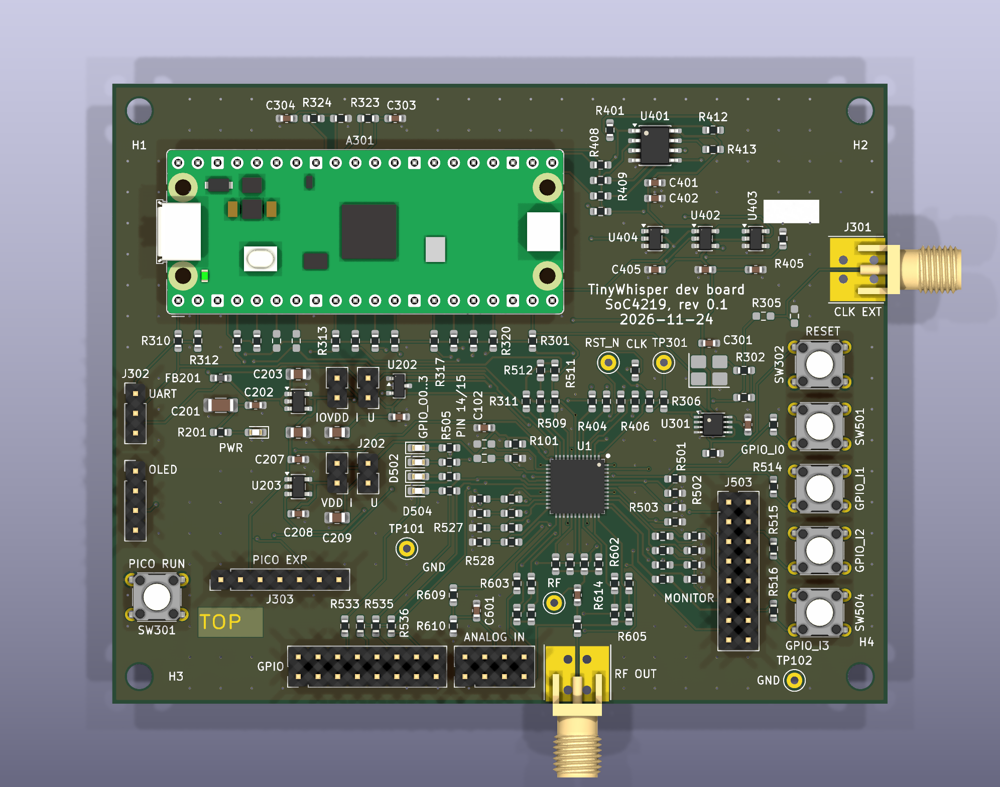
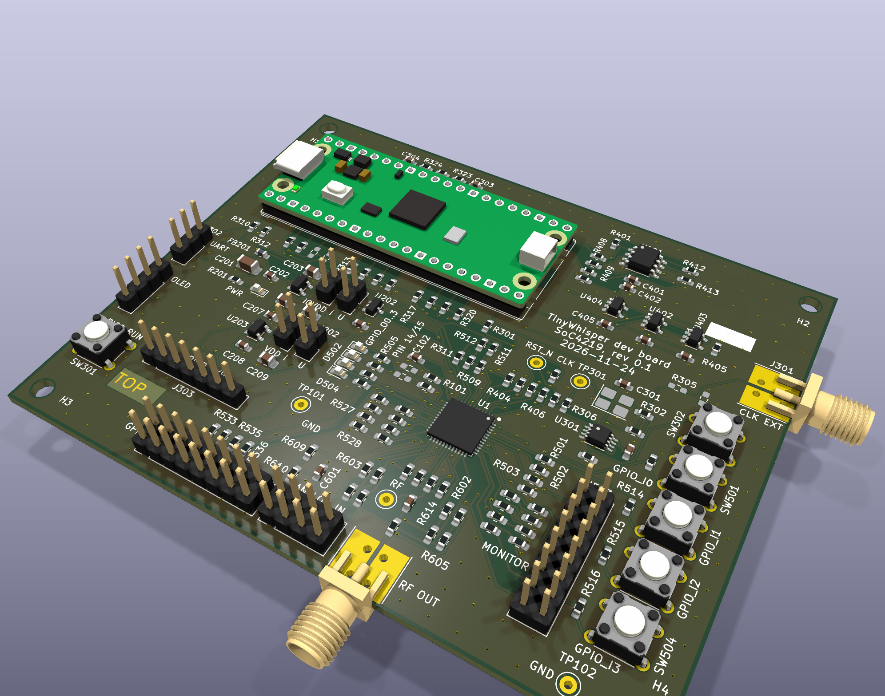
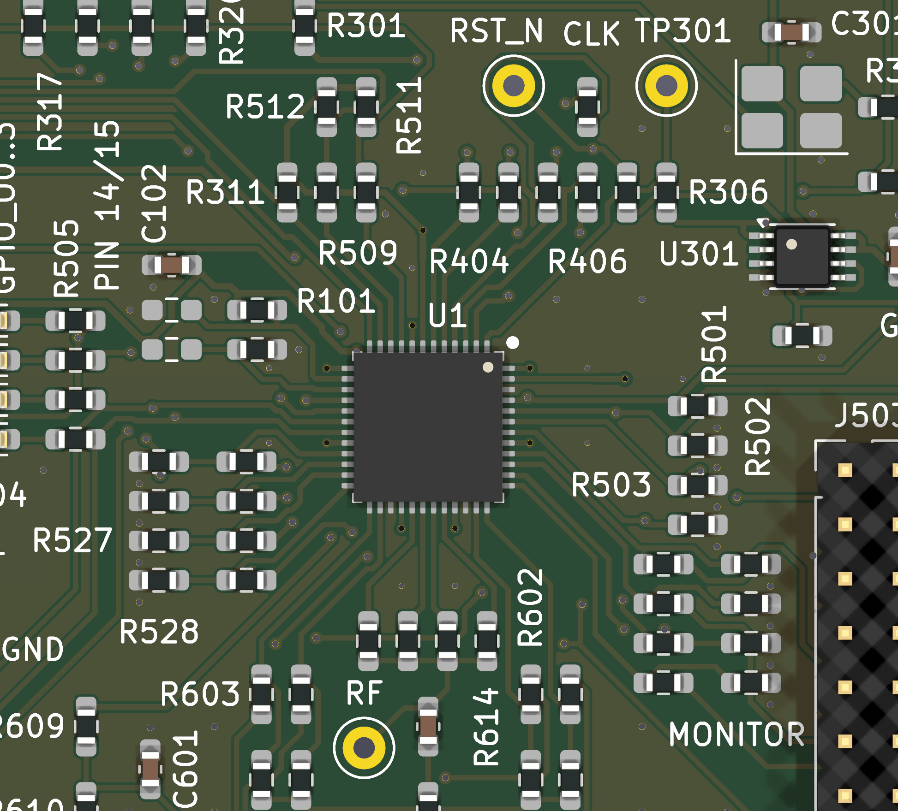
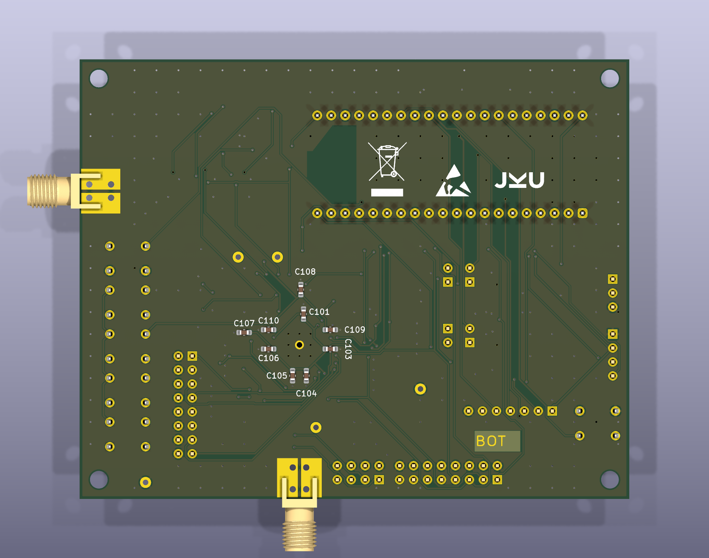

# TinyWhisper dev board

KiCad 10 project of the bring-up board for SoC4219, the first TinyWhisper silicon, in its open-molded QFN-48.
Revision 0.1 covers the digital side completely and gives the RF side debug access only: the four RF outputs joined into a 1 kΩ load and an SMA for a spectrum analyzer, with no band-pass filter, no band switching and no power amplifier.
Every board condition of [`ihp130/doc/errata.md`](../ihp130/doc/errata.md) is built in and cited as `TW-Exx`. [`measurements/README.md`](../measurements/README.md) is the bring-up protocol for this board.

<p align="center">
  
  
</p>
<p align="center">
  
  
</p>

## Files

| File | Contents |
| --- | --- |
| `tinywhisper_dev_board.kicad_pro` | Project: net classes (`Default`, `Power`), design rules, track and via presets |
| `tinywhisper_dev_board.kicad_sch` | Root sheet: chip, decoupling, straps for the two bond plans, mechanics |
| `power.kicad_sch` | 5 V from the Pico, 3.3 V board rail, `IOVDD` with its supervisor, `VDD` |
| `host.kicad_sch` | Raspberry Pi Pico H, 56 MHz clock, reset flip-flop, UART, links to the chip |
| `memory.kicad_sch` | PSRAM and the chip-side bus buffers |
| `user.kicad_sch` | Buttons, LEDs, I2C, GPIO header, monitor pads |
| `analog.kicad_sch` | External analog inputs, RF debug output |
| `tinywhisper_dev_board.kicad_pcb` | Board, revision 0.1 |
| `tinywhisper_dev_board.kicad_dru` | Custom rules: the stricter value of JLCPCB and Aisler per rule, plus house rules |
| `lib/` | Chip symbol, Pico H symbol, QFN-48 land pattern, Pico socket, SMA and the board-only logos |
| `render/` | Renders of the board |

Stock parts use the KiCad 10 libraries, and their 3D models resolve through `${KICAD10_3DMODEL_DIR}`.

## Chip

| Item | Value |
| --- | --- |
| Package | QP Technologies `QP-QFN48-7MM-0.50MM` (dwg 500363 rev A), the EUROPRACTICE `OP_QFN48`: 7 × 7 mm, 0.5 mm pitch, 0.23 mm leads, 5.1 mm exposed pad |
| Land pattern | 0.25 mm lands from 3.0 to 4.05 mm off the centre (0.55 mm toe for an iron), 5.1 mm exposed pad with a 1.0 mm plated hole for soldering from the bottom |
| Ground | The exposed pad is the only ground of the die: all 9 `VSS` and 3 `IOVSS` pads are downbonded to the paddle, and the leads 15, 27, 34 and 46 are bonded to it ([`ihp130/packaging/config.yaml`](../ihp130/packaging/config.yaml)). Eight vias in the pad tie it to all four layers. |
| Orientation | Turned by 270°: pins 1 to 12 (clock, reset, SPI, I2C, UART) face the Pico and the PSRAM, pins 25 to 36 (analog inputs, RF) face the RF SMA |
| Decoupling | 100 nF 0603 per supply pin on the bottom side, `C101` to `C107` for the `VDD` pins 8, 14, 20, 28, 33, 41, 47 and `C108` to `C110` for the `IOVDD` pins 7, 13, 48. Each supply pin has a fixed escape on `F.Cu` to a via in the supply pad of its own capacitor, 4.75 mm from the chip centre, and each capacitor's ground pad a via on the same axis. Pins 7 and 47 sit next to the supply pins 8 and 48, so their escapes run past those vias to `C108` and `C107` at 9.2 mm. Pin 14 reaches `VDD` through the strap `R101`, with `C102` beside it. |
| Escapes | Every other signal pin has a straight 0.25 mm stub out to 5.3 mm from the centre, so the autorouter starts outside the ring of supply vias. The vias on the pin axes are 0.45 mm with a 0.25 mm drill and the escapes 0.25 mm wide near the chip, so a neighbouring escape passes a via at the 0.15 mm clearance. |

Pins 14 and 15 were swapped in the bond plan of 2026-11-11 (TW-D03). The board straps both variants:

| Bond plan | Pin 14 | Pin 15 | Fit |
| --- | --- | --- | --- |
| 2026-11-11 (`ihp130/packaging/result.md`, default) | `VDD` | `IOVSS` lead to the cavity | `R101`, `R103` |
| Before 2026-11-11 | `IOVSS` | `VDD` | `R102`, `R104` instead |

Check one loose part before soldering: pin 15 against the exposed pad reads about 0 Ω for the plan of 2026-11-11. Step 1 of [`measurements/README.md`](../measurements/README.md) has the full check.

## Supplies

| Rail | Source | Load |
| --- | --- | --- |
| `+5V` | Pico `VBUS` (pin 40) through the ferrite `FB201`, so the Pico's USB powers the board | `U201` |
| `+3V3` | `U201` AP2112K-3.3, 600 mA | Pico interface, PSRAM, bus buffers, oscillator, reset flip-flop, OLED, `IOVDD`, `VDD` regulator |
| `IOVDD` | `+3V3` through the current jumper `JP201`, voltage header `J201` | Chip I/O ring (3 pins), the pull-ups on chip inputs |
| `VDD` | `U203` LP5907MFX-1.5 from `+3V3`, through the current jumper `JP202`, voltage header `J202` | Chip core (7 pins): CPU and IQ modulator share it (TW-E28) |

Sequencing (TW-E31): the supervisor `U202` (TPS3839K33) raises `PG_IO` 200 ms after `IOVDD` exceeds 2.93 V. `PG_IO` enables `U203`, so `VDD` follows `IOVDD`, and the LP5907 output discharge pulls `VDD` down first when `IOVDD` drops. `PG_IO` also clears the reset flip-flop, so `rst_n` stays low without `IOVDD`.
The LP5907 sees 6.4 µF on its output (`C208`, `C209` and the seven `VDD` decoupling capacitors), within its 10 µF limit.

Pull `JP201` or `JP202` to measure a current with an ammeter, or to feed a current-limited bench supply into pin 2 of the jumper (the chip side) with `GND` on pin 2 of `J201` or `J202`. With the bench supply, bring up `IOVDD` before `VDD`.

## Host

A Raspberry Pi Pico H (RP2040) on two 1x20 sockets loads the program, owns reset and the PSRAM bus, and bridges USB to the chip's UART, as the RP2040 does on pico-ice.

| Pico | Net | Function |
| --- | --- | --- |
| `GP0` | `UART_RX` through `R310` 1 kΩ | Chip `rx` (pin 11), 10 kΩ pull-up `R311` to `IOVDD` (TW-E29) |
| `GP1` | `UART_TX` through `R312` 1 kΩ | Chip `tx` (pin 12) |
| `GP2` | `BUS_PICO`, 10 kΩ pull-up `R326` | High: the Pico owns the PSRAM and the chip-side buffers are off (TW-E02) |
| `GP3` | `RST_REQ_N` through `R307` 1 kΩ, 10 kΩ pull-down `R308` | Reset request into the flip-flop, low until the firmware releases it |
| `GP4`, `GP5` | `SDA`, `SCL` through `R321`, `R322` (not fitted) | I2C sniffer, the chip stays the only master (TW-E14) |
| `GP6` to `GP9` | `gpio_in[0..3]` through 1 kΩ (`R313` to `R316`) | Drive the chip inputs, `gpio_in[0]` is the external interrupt (TW-E24) |
| `GP10` to `GP13` | `gpio_out[0..3]` through 1 kΩ (`R317` to `R320`) | Read the chip outputs |
| `GP14` | `CLK_OE`, 10 kΩ pull-up `R301` | Oscillator enable, on while the pin is an input |
| `GP16` to `GP19` | `PSRAM_SO` (`R411`), `PSRAM_CE_N` (`R408`), `PSRAM_SCLK` (`R409`), `PSRAM_SI` (`R410`), 100 Ω each | SPI0 to the PSRAM: MISO, CS, SCK, MOSI |
| `GP26` | `VDD` through `R323` 1 kΩ | ADC readback of `VDD` |
| `GP27` | `IOVDD / 2` (`R324`, `R325`) | ADC readback of `IOVDD` |
| `GP15`, `GP20` to `GP22`, `GP28` | `J303` | Spare |
| `RUN` | `SW301` | Pico reset |

Loading order: with `BUS_PICO` high the Pico writes the program into the PSRAM over SPI0 (150 µs after power-up at the earliest), checks `VDD` on `GP26`, sets `BUS_PICO` low and raises `RST_REQ_N`. The flip-flop then releases `rst_n` on the next rising clock edge.

## Clock and reset

- `X301` is a 56 MHz SiT8008 CMOS oscillator at 3.3 V (programmable family, any frequency to order). `R304` (0 Ω, fitted) selects it. For a generator, fit `R305` instead and drive the SMA `J301` with a 3.3 V CMOS square wave. `R303` (49.9 Ω, not fitted) terminates a generator that needs it.
- The clock passes `R306` (33 Ω) to pin 1 and clocks the reset flip-flop `U301` (74AUP1G74 at 3.3 V, clock input high at 2.0 V or more). On 10 m the clock duty sets the I/Q balance (TW-E27): trim it with a generator on `J301`.
- `U301` releases `rst_n` (through `R309`, 33 Ω) synchronous to the clock (TW-E25), clears it while `PG_IO` is low (TW-E31), and `SW302` (RESET) pulls its D input low.
- Test points: `TP301` on `CLK` at the chip, `TP302` on `RST_N`.

## Memory

The CPU fetches from `U401`, an APS6404L-3SQR 64 Mbit SPI PSRAM at 3.3 V.
The chip's `si`, `sclk` and `sram_ce` drive even in reset and `sclk` runs at 28 MHz without pause (TW-E02), so they reach the PSRAM through the tri-state buffers `U403` (`si`), `U402` (`sclk`) and the inverting `U404` (`sram_ce` is active high, TW-E01), all enabled while `BUS_PICO` is low. `R401` keeps `CE#` high while nobody drives it, and `R405` keeps the inverter input low with the chip unpowered.
The series resistors `R402` to `R404` and `R406` (33 Ω) sit at the chip pins, and `R407` pulls `so` up (TW-E29).

## User I/O

| Part | Function |
| --- | --- |
| `SW501` to `SW504` | Buttons on `gpio_in[0..3]`, 1 kΩ to `IOVDD` (`R513` to `R516`), 10 kΩ pull-downs (`R501` to `R504`, TW-E29) |
| `D501` to `D504` | LEDs on `gpio_out[0..3]` through 1 kΩ (`R505` to `R508`) |
| `J501` | I2C display module: 1 `GND`, 2 `+3V3`, 3 `SCL`, 4 `SDA`. The chip drives `SDA` high push-pull, so 100 Ω in series (`R509`, `R510`) and 4.7 kΩ pull-ups to `IOVDD` (`R511`, `R512`). Fast-mode slaves that never stretch the clock (TW-E14, TW-E15). |
| `J302` | UART: 1 `tx` (chip output), 2 `rx` (chip input), 3 `GND`. The host sends 2 stop bits (TW-E07). |
| `J303` | Spare Pico pins: 1 `+3V3`, 2 `GP15`, 3 `GP20`, 4 `GP21`, 5 `GP22`, 6 `GP28`, 7 `GND` |

`J502` (GPIO) and `J503` (monitor pads) have the signals on the odd pins and `GND` on every even pin:

| Pin | `J502` | `J503` |
| --- | --- | --- |
| 1 | `gpio_in[0]` | `lo_I` (pin 38) |
| 3 | `gpio_in[1]` | `lo_Ix` (pin 37) |
| 5 | `gpio_in[2]` | `lo_Q` (pin 23) |
| 7 | `gpio_in[3]` | `lo_Qx` (pin 24) |
| 9 | `gpio_out[0]` through 100 Ω | `ds_I_p` (pin 40) |
| 11 | `gpio_out[1]` through 100 Ω | `ds_I_n` (pin 39) |
| 13 | `gpio_out[2]` through 100 Ω | `ds_Q_p` (pin 21) |
| 15 | `gpio_out[3]` through 100 Ω | `ds_Q_n` (pin 22) |

The eight monitor pads drive 30 mA at the LO rate whenever the internal LO runs (TW-E26). Each reaches `J503` through 100 Ω at the chip (`R517` to `R524`) and has a 100 kΩ pull-down at the pin (`R525` to `R532`), because the reset value of `FREQ_STATUS` makes them inputs (TW-E04).

## Analog inputs and RF debug output

- `J601` brings out the four external analog inputs (1 `vinp_I`, 3 `vinn_I`, 5 `vinp_Q`, 7 `vinn_Q`, even pins `GND`). Each passes 1 kΩ (`R601` to `R604`) and is biased to `VCM` = 0.75 V through 100 kΩ (`R605` to `R608`, divider `R609`, `R610` from `VDD`). Keep them within 0 to 1.5 V and never drive them with the chip unpowered: their clamps go to `IOVDD` (TW-E30).
- The four RF outputs (pins 29 to 32) are joined through the 0 Ω links `R611` to `R614` into `RF_SUM` (TW-E03, test point `TP601`). `C602` (100 nF) blocks their 0.75 V DC level (TW-E30), and `R615` (953 Ω) feeds the end-launch SMA `J602`. With a 50 Ω analyzer the outputs see 1003 Ω, and the analyzer reads 26.0 dB below the voltage at `RF_SUM`. Remove three links to measure one output alone.
- There is no filter on this board: the switching mixer puts power at odd LO harmonics. Use `J602` only into an analyzer or through an external low-pass filter.

## Assembly

All passives are 0603 or larger and all ICs leaded or with a land toe (SOT-23, SSOP-8, SOIC-8, the QFN-48 with extended lands), so the board can be soldered by hand. Connectors, buttons and test points are through-hole.
The QFN-48 exposed pad is soldered from the bottom through its 1.0 mm hole, or on a hot plate. The decoupling capacitors `C101` to `C110` sit on the bottom side under the chip, so solder the chip first.
The Pico H sits on two 1x20 sockets (Sullins PPTC201LFBN-RC), so it can be replaced and its own pins stay free.

## Markings

- Layer marker below the spare Pico header: `TOP` (`F.Cu`) and `2` (`In1.Cu`) read from the top, `3` (`In2.Cu`) and `BOT` (`B.Cu`), mirrored, from the bottom, in rule areas that forbid only the pour.
- Write-on field for the part number above the title.
- Every connector, jumper, button and test point is named by function. The supply jumpers read `IOVDD I` and `VDD I`, their voltage headers `U`, and `TP601` (`RF_SUM`) reads `RF`.
- JKU, ESD and WEEE logos on the bottom silkscreen, as board-only footprints (no symbol, not in the BOM or the position files).

## Fabrication

The board fits both JLCPCB and Aisler on one rule set, as the SPARX probe board: per rule the stricter value of the two.

| Rule | Value |
| --- | --- |
| Track and space | 0.125 mm (signals routed at 0.25 mm, supplies at 0.3 mm with 0.25 mm necks into the QFN-48 lands) |
| Vias | 0.25 to 0.45 mm drill, 0.1 mm ring, 0.45 mm diameter or more (the board uses 0.3 mm in 0.6 mm, and 0.25 mm in 0.45 mm at the chip supply pins) |
| Plated through holes | 0.3 mm ring |
| Hole to hole | 0.45 mm, via to via 0.3 mm |
| Hole to copper | 0.28 mm, via hole 0.25 mm |
| Copper to edge | 0.5 mm (house rule), 0.3 mm at the two SMA launches |
| Silkscreen text | 1.0 mm high, 0.15 mm stroke |

The board file carries Aisler's 4-layer stackup: 1.6 mm, ENIG, 35 µm copper, `In1.Cu` and `In2.Cu` solid ground planes, signals on `F.Cu` and `B.Cu`. No line needs a controlled impedance: the fastest signal is the 56 MHz clock, and the RF output stays below 30 MHz.

## Checks

The project is ERC clean, the schematic and the board agree (DRC with `--schematic-parity`), and DRC reports no errors and no unconnected items. One warning class is left: 104 `track_angle`, the house 45° rule at the 48 T-junctions and 2 via joints the autorouter left, each reported at its tracks. No plain corner is below 45°.
75 of 169 references are hidden on the silkscreen, where no free spot is next to the part, mostly among the 0603 parts around the chip. They stay on the fab layer.

From the repo root:

```sh
mkdir -p build
kicad-cli sch erc --severity-all --format json -o build/pcb_erc.json pcb/tinywhisper_dev_board.kicad_sch
kicad-cli pcb drc --severity-all --schematic-parity --format json -o build/pcb_drc.json pcb/tinywhisper_dev_board.kicad_pcb
kicad-cli pcb render --quality high --use-board-stackup-colors -o build/board.png pcb/tinywhisper_dev_board.kicad_pcb
```

## Open points

- Pico firmware: PSRAM load, bus handover, `VDD` check, reset release, UART bridge, time for WSPR.
- The bond diagram of the `SoC4219` lot (TW-D03), before the first part is soldered.
- The QFN-48 land pattern against real parts: QP publishes no land pattern.
- The orderable part number of `X301` for 56 MHz.
- A review of the layout: everything outside the chip escapes and the ground fan-out is autorouted (Freerouting) and cleaned up to 45° corners by script.
- The hidden references: decide which stay hidden, then move or shrink parts for the rest.
